# Technical Architecture & Expected Integrations Specification (Multi-Store Facilitator & Outsourced Delivery)

## 1. System Architecture Overview

The platform is architected as a **Zero-Inventory Multi-Store Marketplace Facilitator** built on the **WooCommerce REST API v3 (`/wp-json/wc/v3/*`) + High-Performance Order Storage (HPOS)** pattern, serving **6 connected interfaces** across Web and Native Mobile Apps (`Flutter`):

1. **Client Web Storefront (`Tab 1`)**: Features hyperlocal location selector bar, Category pills, Partner Store filter, 3-step checkout, and floating **💬 Support Chat Drawer**.
2. **Client My Orders & Tracking Hub (`Tab 2`)**: Features Step 6 & 7 client order confirmation/rejection banner, Step 13 **4-digit Handover PIN display** (with COD no-PIN badge), 7-stage visual milestone stepper, and printable tax invoices.
3. **iOS & Android Mobile App Simulator (`Tab 3`)**: Mobile shopping simulator with Apple Pay / Meeza integration and live push notification stream.
4. **Partner Store Portal (`Tab 4`)**: Dedicated Step 5 **Store Item Availability Review Card** (checkboxes to confirm in-stock items or de-select out-of-stock items), packaging status manager, and inventory controls.
5. **Outsourced Delivery Hub (`Tab 5`)**: Proximity courier dispatch engine, branch pickup confirmation, client arrival marker, and Step 14 Handover PIN verification (or COD cash collection without PIN).
6. **Facilitator Control Tower (`Tab 6`)**: Commercial policy rules, customer support chat desk, 360° order inspector, inventory manager, and HMAC webhook audit log.

```mermaid
flowchart TB
    subgraph Touchpoints["6 Role-Based Interfaces (Web + Flutter iOS/Android)"]
        ClientWeb["1. Client Web Storefront (Location & Store Filter)"]
        ClientOrders["2. My Orders & Tracking (Confirmations & Handover PIN)"]
        ClientApp["3. iOS & Android Flutter App (Apple Pay & FCM Push)"]
        StorePortal["4. Partner Store Portal (Stock Review & Packaging)"]
        DeliveryHub["5. Outsourced Delivery Hub (Proximity Dispatch & PIN Verify)"]
        AdminConsole["6. Facilitator Admin (Commercial Rules & Support Desk)"]
    end

    subgraph CoreEngine["Core Marketplace Facilitator Engine (Port 4000)"]
        REST["WooCommerce v3 REST API (/wp-json/wc/v3/*)"]
        SplitEngine["Multi-Store Cart & Commission Split Calculator"]
        CourierEngine["Proximity Courier Dispatcher (COURIER_FLEET)"]
        ReviewEngine["Store Availability Review & Client Confirmation Gate"]
        HandoverEngine["Handover PIN Validator (Prepaid PIN vs. COD Cash)"]
        OrderEnricher["Order Lifecycle & 7-Stage Milestone Enricher"]
        StockSaga["Store Inventory Reservation & Auto-Release"]
        WebhookAuth["HMAC-SHA512 Webhook Security Verifier"]
        DB[("HPOS SQLite DB (wc_categories, wc_stores, wc_products, wc_orders, wc_deliveries, wc_settlements)")]
    end

    subgraph ExternalIntegrations["Fintech & Outsourced 3PL Couriers (Port 4001 Mockup)"]
        PaymobSplit["Paymob Accept / Split API (Pre-Auth -> Capture Hold)"]
        Fawry["FawryPay Reference Code API (48h Store Stock Hold)"]
        ValU["valU BNPL API (6/12/24m Installments)"]
        WhatsApp["WhatsApp Cloud API (COD OTP 4455 Verification)"]
        Bosta3PL["Bosta & Local Courier Fleet (Proximity Pickup -> Delivery)"]
    end

    ClientWeb --> REST
    ClientOrders --> REST
    ClientApp --> REST
    StorePortal --> REST
    DeliveryHub --> REST
    AdminConsole --> REST

    REST --> SplitEngine
    REST --> CourierEngine
    REST --> ReviewEngine
    REST --> HandoverEngine
    REST --> OrderEnricher
    REST --> StockSaga
    REST --> WebhookAuth

    SplitEngine --> DB
    CourierEngine --> DB
    ReviewEngine --> DB
    HandoverEngine --> DB
    OrderEnricher --> DB
    StockSaga --> DB

    ReviewEngine <-->|"Two-Phase Hold"| PaymobSplit
    CourierEngine <-->|"Proximity Dispatch"| Bosta3PL
```



---

## 2. Database Schema Extensions (HPOS SQLite)

To support the 14-step fulfillment cycle, proximity fleet dispatch, and Handover PIN security, the SQLite HPOS schema includes the following fields:

### `wc_orders` Table
* `delivery_pin TEXT`: 4-digit cryptographic Handover PIN generated at checkout (e.g. `7985`).
* `assigned_courier_name TEXT`: Full name of assigned proximity courier.
* `assigned_courier_phone TEXT`: Contact phone number of courier.
* `assigned_courier_vehicle TEXT`: Vehicle type (e.g. `🛵 Motorcycle`, `🚗 Van`).
* `store_review_status TEXT`: Status of merchant availability review (`AWAITING_REVIEW`, `STORE_CONFIRMED`).
* `order_status TEXT`: Extended statuses: `pending-store-review`, `store-reviewed`, `ready-to-ship`, `processing`, `in-transit`, `completed`, `completed-settled`, `cancelled`.
* `payment_status TEXT`: Extended statuses: `pre_authorized`, `paid`, `pending_cod_collection`, `settled`, `voided`.

### `wc_deliveries` Table
* `delivery_pin TEXT`: Synced 4-digit Handover PIN.
* `courier_name TEXT`: Assigned courier name.
* `courier_phone TEXT`: Assigned courier phone.
* `courier_vehicle TEXT`: Courier vehicle type.
* `courier_distance_km REAL`: Proximity distance from courier to store pickup branch (e.g. `0.8`).
* `courier_status TEXT`: Lifecycle stages: `SEARCHING_COURIER`, `COURIER_ASSIGNED`, `PICKED_UP_FROM_STORE`, `OUT_FOR_DELIVERY`, `ARRIVED_AT_CLIENT`, `DELIVERED`.

### `wc_order_items` Table
* `item_status TEXT`: In-stock confirmation status (`IN_STOCK`, `OUT_OF_STOCK`).

---

## 3. Courier Fleet Proximity Dispatch Registry

The platform maintains an active registry of local couriers (`COURIER_FLEET`) categorized by Egyptian governorate SLA coverage:

| Courier Name | Governorate Coverage | Vehicle | Contact Phone | Proximity Baseline (km) |
| :--- | :--- | :--- | :--- | :--- |
| **Tarek Mostafa** | `CAIRO` (Nasr City / New Cairo) | 🛵 Motorcycle | `01098765432` | `0.8 km` |
| **Mahmoud Hassan** | `CAIRO` (Downtown / Maadi) | 🛵 Motorcycle | `01123456789` | `1.4 km` |
| **Karim Adel** | `GIZA` (Dokki / Mohandessin) | 🛵 Motorcycle | `01234567890` | `1.2 km` |
| **Ahmed Samy** | `GIZA` (6th of October / Zayed) | 🚗 Delivery Van | `01011223344` | `2.5 km` |
| **Mostafa Ibrahim** | `ALEX` (Smouha / Sidi Gaber) | 🛵 Motorcycle | `01199887766` | `0.9 km` |
| **Youssef Nabil** | `ALEX` (Gleem / Montaza) | 🚗 Delivery Van | `01288776655` | `2.1 km` |
| **Ibrahim Kamel** | `ALL` (Cross-Governorate Heavy 3PL) | 🚚 Medium Truck | `01555667788` | `4.2 km` |

Couriers are queried via `GET /wp-json/wc/v3/couriers/nearby?governorate={GOV}` and sorted by proximity distance.

---

## 4. API Endpoints Specification

### 4.1 Hyperlocal Courier Proximity Search
* **`GET /wp-json/wc/v3/couriers/nearby?governorate={GOV}`**
  * **Query Params:** `governorate` (`CAIRO`, `GIZA`, `ALEX`).
  * **Response:** Returns list of available fleet couriers sorted by `base_distance_km`.

### 4.2 Partner Store Item Availability Review (Step 5)
* **`POST /wp-json/wc/v3/orders/{id}/store-review`**
  * **Body:**
    ```json
    {
      "store_id": 1,
      "items": [
        {"product_id": 1, "available": true},
        {"product_id": 2, "available": false}
      ]
    }
    ```
  * **Logic:** Sets item status (`IN_STOCK` vs `OUT_OF_STOCK`), releases reserved inventory for unavailable items, recalculates line totals, subtotal, VAT, delivery fee, and order total. Sets `order_status = 'store-reviewed'` and `store_review_status = 'STORE_CONFIRMED'`.

### 4.3 Client Order Confirmation / Rejection (Steps 6 & 7)
* **`POST /wp-json/wc/v3/orders/{id}/client-confirm`**
  * **Body:** `{"action": "CONFIRM"}` or `{"action": "REJECT"}`
  * **Logic:**
    * On `CONFIRM`: Captures money from pre-authorized card (`payment_status = 'paid'`), moves order to `order_status = 'ready-to-ship'`.
    * On `REJECT`: Releases all reserved units, voids pre-authorization hold, sets `order_status = 'cancelled'`.

### 4.4 Courier Assignment (Step 9)
* **`POST /wp-json/wc/v3/deliveries/{id}/assign-courier`**
  * **Body:**
    ```json
    {
      "courier_name": "Tarek Mostafa",
      "courier_phone": "01098765432",
      "courier_vehicle": "🛵 Motorcycle",
      "courier_distance_km": 0.8
    }
    ```
  * **Logic:** Updates delivery record, sets `courier_status = 'COURIER_ASSIGNED'`, syncs courier metadata to parent order.

### 4.5 Courier Branch Pickup Confirmation (Steps 10 & 11)
* **`POST /wp-json/wc/v3/deliveries/{id}/courier-pickup`**
  * **Logic:** Sets `courier_status = 'PICKED_UP_FROM_STORE'`, triggers client push notification: *"Your order was picked up by courier Tarek Mostafa and is en route"*.

### 4.6 Courier Arrival at Client (Step 12)
* **`POST /wp-json/wc/v3/deliveries/{id}/courier-arrived`**
  * **Logic:** Sets `courier_status = 'ARRIVED_AT_CLIENT'`, notifies client to prepare Handover PIN or COD cash.

### 4.7 Handover PIN Verification & Cash Settlement (Steps 13 & 14)
* **`POST /wp-json/wc/v3/deliveries/{id}/verify-handover`**
  * **Body:** `{"pin": "7985"}` (or `{"pin": ""}` for COD).
  * **Security Rules:**
    * **Prepaid Orders:** Validates `entered_pin == delivery_pin`. If mismatched, returns HTTP 400 with error message.
    * **COD Orders:** **Crucial Rule:** *In case of cash on delivery, no need for the code.* Handover proceeds directly upon cash collection.
  * **Post-Action:** Sets `courier_status = 'DELIVERED'`, sets `settlement_status = 'SETTLED_TO_STORE'`, generates settlement reference (`STL-xxxxxx`), releases net store payout, and realizes platform commission.

---

## 5. Visual 7-Step Milestone Timeline

Every order returned by `enrich_order_dict` renders a 7-stage progress stepper:
1. `1. Location Matched & Order Placed`
2. `2. Store Item Availability Review`
3. `3. Client Confirmation & Payment Capture`
4. `4. Store Packaging (Origin Branches)`
5. `5. Proximity Courier Assigned & Pickup`
6. `6. Courier at Client & Handover PIN/Cash`
7. `7. Package Delivered & Cash Settled`
