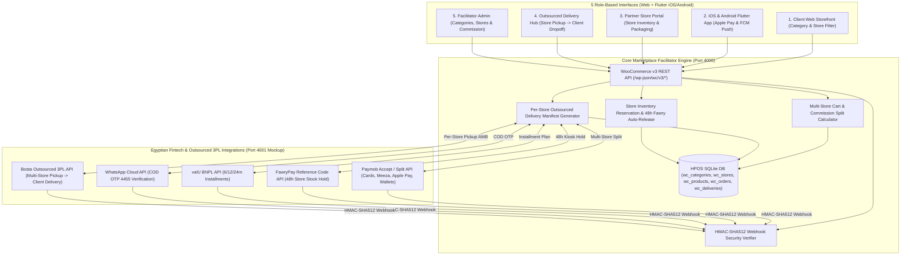
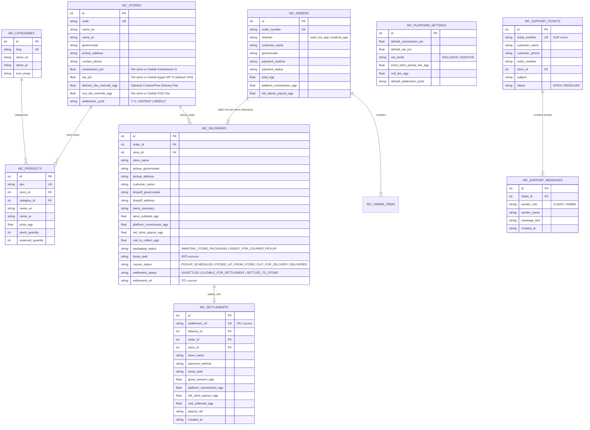

# Technical Architecture & Expected Integrations Specification (Multi-Store Facilitator & Outsourced Delivery)

## 1. System Architecture Overview

The platform is architected as a **Zero-Inventory Multi-Store Marketplace Facilitator** built on the **WooCommerce REST API v3 (`/wp-json/wc/v3/*`) + High-Performance Order Storage (HPOS)** pattern, serving **5 connected interfaces** across Web and Native Mobile Apps (`Flutter`):

1. **Client Web Storefront (`Tab 1`)** & **iOS/Android Mobile App (`Tab 2`)**: High-readability Light/Dark adaptive UI (`Plus Jakarta Sans` + `Cairo`) with rounded Category pills, Partner Store filter, 3-step guided checkout, and floating **💬 Support Chat Drawer**.
2. **Partner Store Portal (`Tab 3`)**: Interactive **1-Click Store Switcher Cards**, top-priority **Incoming Sub-Orders to Pack** table, and Store-Owned Inventory manager.
3. **Outsourced Delivery Hub (`Tab 4`)**: Direct **Partner Store Pickup $\rightarrow$ Client Drop-off** dispatch board with a **Guided Next-Step Pipeline Button** (`Step 1: Store Packed` $\rightarrow$ `Step 2: Bosta Picked Up` $\rightarrow$ `Step 3: Out for Delivery` $\rightarrow$ `Step 4: Delivered` $\rightarrow$ `Step 5: Settle Cash`).
4. **Facilitator Control Tower (`Tab 5`)**: Organized into **5 focused sub-tabs** (`Commercial Rules & Fees`, `Customer Support Chat Desk`, `Orders, Deliveries & Settlements`, `All-Stores Inventory, Stores & Categories`, `Webhooks Inspector`, plus `Show All`) for clutter-free 360° administration.

---

## 2. Multi-Store & Outsourced Delivery Database Schema (ER Diagram)

---

## 3. REST API Contracts & New Multi-Store Endpoints

| HTTP Method & Endpoint | Actor / Consumer | Description |
| :--- | :--- | :--- |
| `GET /wp-json/wc/v3/products/categories` | Client Web, Mobile App, Store Portal | Lists all **Product Categories** with bilingual names, icons, and active SKU counts. |
| `POST /wp-json/wc/v3/products/categories` | Facilitator Admin | Creates a new **Product Category** (`slug`, `name_en`, `name_ar`, `icon_emoji`). |
| `GET /wp-json/wc/v3/stores` | All Interfaces | Lists all onboarded **Partner Stores**, pickup addresses, commission rates (`%`), and live payout ledgers (`gross_sales_egp`, `commission_egp`, `net_payout_egp`, `settled_payout_egp`, `pending_payout_egp`). |
| `POST /wp-json/wc/v3/stores` | Facilitator Admin | Onboards a new **Partner Store** with its Governorate pickup origin and commission rate. |
| `POST /wp-json/wc/v3/products` | Partner Store Portal | Publishes a new store-owned **Product** (`store_id`, `category_id`, `sku`, `name_en`, `name_ar`, `price_egp`, `stock_quantity`). |
| `POST /wp-json/wc/v3/products/{id}/stock` | Partner Store Portal | Allows a Partner Store to increment/decrement its own `stock_quantity` while protecting `reserved_quantity`. |
| `POST /wp-json/wc/v3/cart/calculate` | Client Web, Mobile App | Calculates multi-store cart totals, promo discounts (`EGYPT10`, `RAMADAN200`), multi-origin Bosta delivery fees, **Platform Commission**, and **Net Store Payouts**. |
| `POST /wp-json/wc/v3/orders` | Client Web, Mobile App | Reserves stock in each Partner Store, splits items by `store_id` into `wc_deliveries` manifests, and initializes the chosen Egyptian payment gateway on Port `4001`. |
| `GET /wp-json/wc/v3/deliveries` | Outsourced Delivery Hub, Store Portal | Lists all **Store-to-Client Outsourced Delivery Manifests**, including pickup origin, client destination, packaging state, Bosta AWB status, and `settlement_status`. |
| `POST /wp-json/wc/v3/deliveries/{id}/store-ready` | Partner Store Portal | Marks a store sub-order `READY_FOR_COURIER_PICKUP` and fires a push notification to the Outsourced Delivery Hub and Client App. |
| `POST /wp-json/wc/v3/deliveries/{id}/settle` | Store Portal, Delivery Hub, Admin | Triggers **Cash Settlement** via Port `4001` (`/mock/settlement/v1/payout`), firing an HMAC-verified `SETTLEMENT.COMPLETED` webhook to `/wp-json/wc/v3/webhooks/settlement` and recording `STL-xxxxxx` in `wc_settlements`. |
| `POST /wp-json/wc/v3/settlements/settle-bulk` | Facilitator Admin | Bulk-settles all `DELIVERED` sub-orders across **ALL Partner Stores (`store_id: "all"`)** or a **Specific Store (`store_id`)**. |
| `GET /wp-json/wc/v3/settlements` | Facilitator Admin | Lists all completed **Cash Settlement & Commission Realization** transactions (`wc_settlements`). |
| `GET & POST /wp-json/wc/v3/settings/commercial-rules` | Facilitator Admin | Reads or updates **Commission %**, **Egypt VAT %**, **VAT Mode (`INCLUSIVE` \| `ADDITIVE`)**, **Delivery Fee Override (`EGP`)**, **Extra Pickup Fee (`EGP`)**, **COD Fee (`EGP`)**, and **Settlement Cycle** for `target_scope: "all"` or a specific `store_id`. |
| `POST /wp-json/wc/v3/governorates/update` | Facilitator Admin | Updates Bosta 3PL `shipping_egp` and `sla_days` for a single Governorate or `"ALL"` Governorates. |
| `GET & POST /wp-json/wc/v3/support/tickets` | Client Storefront, Facilitator Admin | Lists all customer support chat threads (`SUP-xxxx`) or opens a new support chat from the Client Storefront. |
| `POST /wp-json/wc/v3/support/tickets/{id}/reply` | Client Storefront, Facilitator Admin | Appends a live `CLIENT` or `ADMIN` message to a support thread and dispatches a push notification. |
| `POST /wp-json/wc/v3/support/tickets/{id}/status` | Facilitator Admin | Marks a support ticket `RESOLVED` or `OPEN`. |
| `POST /wp-json/wc/v3/mock-proxy` | All Simulator Actions | Same-origin proxy on Port `4000` that forwards simulator triggers (`path`, `payload`) to Port `4001` (`http://127.0.0.1:4001`), preventing cross-origin blocks and IPv6 localhost resolution lag. |

---

## 4. Expected Production Integrations for Your Facilitator Model

1. **Paymob Split Payments (`POST https://accept.paymob.com/v1/intention/`):**
   * Pass the `store_splits` array in the payment intention request so Paymob automatically routes `net_store_payout_egp` to each Partner Store's sub-merchant account while depositing `platform_commission_egp` into your facilitator account.
2. **Bosta Multi-Pickup API (`POST https://app.bosta.co/api/v2/deliveries`):**
   * For each row in `wc_deliveries`, pass the Partner Store's `pickupAddress` (`city: d.pickup_governorate, firstLine: d.pickup_address`) and the Client's `dropOffAddress` (`city: d.dropoff_governorate, firstLine: d.dropoff_address`). Bosta's courier picks up directly from the Partner Store and delivers to the Client.
3. **FawryPay 48h Store Reservation (`POST https://atfawry.com/ECommerceWeb/Fawry/payments/charge`):**
   * Holds the Partner Store's stock for 48 hours (`reserved_quantity`). If `FAWRY.EXPIRED` arrives, the stock is automatically returned to the Partner Store's available inventory.

---

## 5. Vercel Cloud Deployment Architecture (100% Architectural Parity with Local)

The entire multi-server environment is configured to deploy to **Vercel (`@vercel/python`)** without changing a single line of business logic:

| Local Service | Local URL | Vercel Serverless Route (`vercel.json` $\rightarrow$ `api/index.py`) | Runtime Mechanism |
| :--- | :--- | :--- | :--- |
| **1. Core Marketplace Facilitator Engine** (`ecommerce_server.py`) | `http://localhost:4000` | `/` & `/wp-json/wc/v3/*` | Handled by `EcommerceRequestHandler` backed by SQLite in `/tmp/ecommerce_hpos.db` (auto-initialized & seeded on cold start). |
| **2. Egyptian Fintech & Bosta 3PL Sandbox** (`mock_integrations_server.py`) | `http://localhost:4001` | `/mock-dashboard` & `/mock/*` | Routed to `MockIntegrationsHandler`; outbound API calls and inbound `HMAC-SHA512` webhooks execute in-memory via `invoke_handler_in_memory()` when `VERCEL=1`. |
| **3. Platform Study & Liability Calculator** (`study.html`) | `http://localhost:8080` | `/study` | Served directly from `study.html` on the same Vercel domain. |
