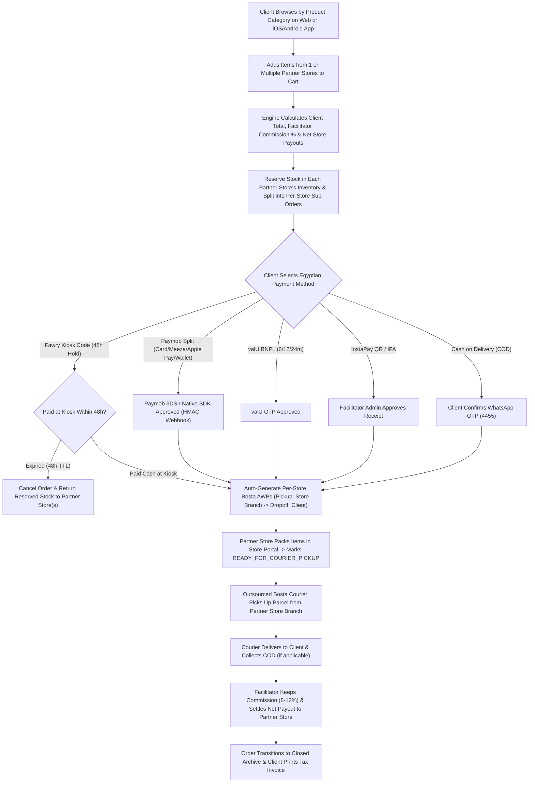

# Business Requirements Document (BRD): Egypt Multi-Store Marketplace Facilitator & Outsourced Delivery Platform

## 1. Executive Summary & Business Model
This Business Requirements Document (BRD) defines the functional, financial, and operational requirements for an **Egyptian Zero-Inventory Multi-Store Marketplace Facilitator** across **Web (Arabic RTL & English)**, **Apple App Store (iOS)**, and **Google Play Store (Android)**.

### Core Business Model Pillars
1. **Zero Platform Inventory Risk:** The platform does **not** own warehouses or hold stock. Instead, **Partner Stores (Merchants)** onboard onto the platform, list their products under standardized **Product Categories**, and manage their own live store inventory.
2. **Client-to-Store Connection & Commission Split:** When a Client places an order (even across multiple Partner Stores in a single cart), the platform calculates the **Platform Facilitator Commission (`8%–12%`)** and the **Net Partner Store Payout (`EGP`)**, processing payments via **Paymob Split / Cards / Meeza / Wallets**, **valU BNPL**, **Fawry 48h Reference Codes**, **InstaPay**, or **Cash on Delivery (COD)**.
3. **100% Outsourced Last-Mile Delivery (Store $\rightarrow$ Client):** Delivery is outsourced to Egyptian 3PL couriers (**Bosta / Mylerz**). Each order automatically splits into **Per-Store Delivery Manifests (`wc_deliveries`)**, instructing the courier to pick up directly from the **Partner Store's branch address** and deliver to the **Client's drop-off address**.
4. **Client Order Monitoring & Historical Closed Archive:** The platform provides clients with full self-service visibility over active in-transit shipments and historical closed orders, 5-stage milestone pipelines, Bosta waybill numbers, printable tax invoices, and 1-click support desk chat.

---

## 2. System Actors & Dedicated Portals

| Actor | Role & Responsibilities | Dedicated PoC Screen / Interface |
| :--- | :--- | :--- |
| **1. Client (Shopper / Consumer)** | Filters products by **Product Category** and **Partner Store**, places multi-store orders, pays via Egyptian payment rails, monitors active shipments and historical closed orders, prints official tax invoices, and initiates **Live Customer Support Chats (`💬 Chat with Support`)**. | **Tab 1:** `🛒 Client Storefront` **Tab 2:** `📦 My Orders & Tracking (Active & Closed Archive)` **Tab 3:** `📱 iOS & Android Mobile App` |
| **2. Partner Store (Merchant / Vendor)** | Manages its own store stock by Category, views incoming store sub-orders, clicks **"Mark Packaged for Bosta Pickup"**, and tracks its **Net Store Payout (EGP)**. | **Tab 4:** `🏪 Partner Store Portal` |
| **3. Outsourced Delivery Coordinator (Bosta / Mylerz 3PL)** | Views **Store Pickup Origin $\rightarrow$ Client Drop-off Destination** manifests, picks up packaged orders from Partner Stores, delivers to Clients, and collects COD cash. | **Tab 5:** `🚚 Outsourced Delivery Hub` |
| **4. Marketplace Facilitator Admin (You)** | Has **360° visibility into everything** (All Stores, All Inventory, All Orders, All 3PL Deliveries, All Cash Settlements, All Webhooks), operates the **🎧 Live Customer Support Desk**, and controls **Commercial Rules (Delivery Fee, Egypt VAT %, Commission %, COD Fee, Cash Settlement Cycle)** across **ALL Partner Stores** or a **Specific Partner Store**. | **Tab 6:** `⚙️ Facilitator Control Tower & Webhooks` |

---

## 3. Functional Business Requirements (FR)

### 3.1 Product Categories & Store-Owned Catalog
* **FR-01 (Product Categories Taxonomy):** All products must be organized under bilingual **Product Categories** (`Electronics & Mobile`, `Egyptian Fashion & Cotton`, `Home & Coffee Appliances`, `Beauty & Skincare`, `Sports & Footwear`), with category filter bars on both Web and iOS/Android apps.
* **FR-02 (Partner Store Attribution & Stock Ownership):** Every product card must clearly display its **Category Badge**, **Fulfilling Partner Store Name & Governorate Origin** (e.g., *Cairo Tech Hub — Cairo*), and real-time **Store Available Stock**.
* **FR-03 (Store Inventory Self-Service):** Partner Stores must be able to adjust their stock levels (`+` / `-`) and publish new products under any Category directly from the **Partner Store Portal**.

### 3.2 Multi-Store Cart, Commission Split & Egyptian Payments
* **FR-04 (Multi-Store Cart & Split Calculation):** When a Client adds products from $N$ different Partner Stores into one cart:
  * Each line item calculates `Platform Commission = Line Total × Store Commission %` and `Net Store Payout = Line Total - Platform Commission`.
  * Outsourced delivery fee calculates the base Governorate SLA rate (`55–95 EGP`) plus `+25 EGP` per additional store pickup origin.
* **FR-05 (Immediate Partner Store Stock Reservation):** Creating an order immediately reserves the requested units in the respective Partner Store's inventory (`reserved_quantity`).
* **FR-06 (Automatic Stock Return on Fawry Expiry / Decline):** If a 48h **Fawry Reference Code** expires (`FAWRY.EXPIRED`) or a **Paymob** payment is declined, the reserved units are automatically returned to the Partner Store's `available_stock`.

### 3.3 Outsourced Delivery Hub (Store Pickup $\rightarrow$ Client Drop-off)
* **FR-07 (Per-Store Delivery Manifest Splitting):** A single Client order containing items from 2 Partner Stores automatically generates **2 separate Outsourced Delivery Manifests (`wc_deliveries`)**, each with its own **Store Pickup Address**, **Client Drop-off Address**, and **Bosta Airway Bill (`BST-xxxxxxx`)**.
* **FR-08 (Store Packaging Handshake):** Partner Stores mark their sub-order `READY_FOR_COURIER_PICKUP` in the **Partner Store Portal**, notifying the **Outsourced Delivery Hub** and triggering a push notification.

### 3.4 Facilitator 360° Control Tower, Commercial Policy Engine & Customer Support Desk
* **FR-09 (Per-Store & All-Stores Commercial Policy Engine):** The Facilitator Admin must be able to configure **Commission %**, **Egypt VAT % (`14%`)**, **VAT Calculation Mode (`INCLUSIVE` vs. `ADDITIVE`)**, **Store Delivery Fee Override (`EGP` or `0 EGP` Free Shipping)**, **Extra Multi-Store Pickup Fee (`EGP`)**, **COD Collection Fee (`EGP`)**, and **Cash Settlement Cycle (`T+1`, `INSTANT`, `WEEKLY`)** across **ALL Partner Stores (`target_scope: "all"`)** or for a **Specific Partner Store (`target_scope: store_id`)**, plus bulk-settle all delivered sub-orders in one click.
* **FR-10 (Two-Way Live Customer Support Chat & 360° Visibility):** The Client Storefront must provide a **"💬 Chat with Support"** drawer for shoppers to open support tickets (`SUP-xxxx`) and exchange live messages with the **Facilitator Admin Customer Support Desk**, while giving the Facilitator Admin full 360° visibility and override controls across all stores, inventory, deliveries, settlements, orders, and webhooks.

### 3.5 Client Order Monitoring, Historical Closed Archive & Tax Invoicing
* **FR-11 (Client Order Tracking & Milestone Pipeline):** Clients must be able to view their complete order history partitioned into **Active & In-Transit** (orders undergoing store packaging, courier pickup, or last-mile delivery) and **Completed & Closed** (delivered, cash-settled, or cancelled orders).
* **FR-12 (5-Stage Visual Stepper):** Each order card must display a real-time 5-stage progress stepper (`1. Order Placed` $\rightarrow$ `2. Payment Verified & Split` $\rightarrow$ `3. Store Packaged` $\rightarrow$ `4. Out for Delivery (Bosta 3PL)` $\rightarrow$ `5. Delivered & Settled`) with bilingual English/Arabic labels and completion timestamps.
* **FR-13 (Per-Store Manifest & Bosta AWB Transparency):** Orders fulfilled by multiple partner stores must display itemized sub-manifests, store origin governorates, packaging status, and direct clickable Bosta waybills (`courier_tracking_id`).
* **FR-14 (Auditable & Printable Egyptian Commercial Tax Invoice):** Clients must be able to view and print official tax invoices (`INV-ORD-xxxx`) complying with **Egyptian E-Commerce Law No. 151/2020** and **VAT Law No. 67/2016**, detailing NileConnect Tax Reg No (`492-817-309`), Commercial Register (`184920`), itemized partner store breakdown, VAT amounts, and delivery charges.
* **FR-15 (Integrated Support Drawer & Cart Reorder):** Clients must be able to open a pre-filled support ticket referencing their specific order number with one click, or re-populate their cart with all order items to reorder seamlessly.

---

## 4. Main Business Flowcharts

### Flow 1: End-to-End Multi-Store Marketplace & Outsourced Delivery Lifecycle

---

### Flow 2: Financial & Commission Split Matrix

| Order Component | Who Pays / Collects | Who Receives It | Example (10,000 EGP Item @ 10% Store Commission + 55 EGP Cairo Bosta) |
| :--- | :--- | :--- | :--- |
| **Product Price Subtotal** | Paid by **Client** | Split between **Partner Store** & **Facilitator** | `10,000 EGP` |
| **Facilitator Commission (`8%–12%`)** | Deducted from Subtotal | **Marketplace Facilitator (You)** | `1,000 EGP` *(Your Net Revenue)* |
| **Net Partner Store Payout** | Settled via Paymob Split / Bank | **Partner Store (Vendor)** | `9,000 EGP` *(Paid to Store)* |
| **Outsourced Delivery Fee** | Paid by **Client** | **3PL Courier (Bosta / Mylerz)** | `55 EGP` *(Covers Store-to-Client Pickup & Delivery)* |

### Flow 3: End-to-End Cash Settlement & Commission Realization (`STL-xxxxxx`)
1. **Eligibility Trigger (`ELIGIBLE_FOR_SETTLEMENT`):** A Partner Store sub-order becomes eligible for Cash Settlement only after the outsourced Bosta courier confirms `DELIVERED` to the Client.
2. **Prepaid Rail Settlement (`Paymob Split / Fawry / valU / InstaPay`):** Upon `POST /wp-json/wc/v3/deliveries/{id}/settle`, the escrow split releases `net_store_payout_egp` to the Partner Store's sub-merchant account and realizes `platform_commission_egp` into the Facilitator's revenue ledger (`STL-xxxxxx`).
3. **COD Rail Settlement (`Bosta COD Remittance -> InstaPay Corporate Payout`):** Bosta remits the collected `cod_to_collect_egp` cash; the Facilitator deducts its `platform_commission_egp` (`8%–12%`) and transfers `net_store_payout_egp` to the Partner Store via InstaPay Corporate / Bank Payout (`STL-xxxxxx`).
4. **Master Order Closure (`completed-settled`):** Once all Partner Store sub-deliveries for an order reach `SETTLED_TO_STORE`, the parent order automatically transitions to `order_status = 'completed-settled'` and `payment_status = 'settled'`.
5. **Historical Archive Partitioning:** Closed orders are preserved in the Client Order History archive with auditable financial summaries, delivery waybill history, and printable invoices.

---

## 5. Non-Functional & Interactive UX Requirements
* **Eye-Friendly Adaptive Light/Dark Theme (`Plus Jakarta Sans` + `Cairo`):** Defaults to a high-contrast, low-glare **Light Theme** (`#f4f7fb` canvas with pure `#ffffff` cards, generous padding, and `14px` readable typography) with a 1-click **🌙 Dark / ☀️ Light Mode Toggle** in the top header.
* **Focused Sub-Workspaces & Guided Step Pipelines (Zero Visual Clutter):**
  * **Tab 1 (Client Storefront):** Fast category browsing, multi-store cart calculations, and 1-click shortcut to track active orders.
  * **Tab 2 (My Orders & Tracking):** Dedicated shopper self-service hub with active vs. closed tabs, live search input, 5-stage visual stepper, and printable tax invoice modal.
  * **Tab 3 (Mobile App Simulator):** iOS & Android mobile shopping experience with live Firebase push feed.
  * **Tab 4 (Partner Store Portal):** Features 1-click **Visual Partner Store Cards** and prioritizes **Incoming Sub-Orders to Pack** at the top of the screen.
  * **Tab 5 (Outsourced Delivery Hub):** Highlights the **Recommended Next Courier Step** (`Step 1: Store Packed` $\rightarrow$ `Step 2: Bosta Picked Up` $\rightarrow$ `Step 3: Out for Delivery` $\rightarrow$ `Step 4: Delivered` $\rightarrow$ `Step 5: Settle Cash`) as a single primary action button.
  * **Tab 6 (Facilitator Control Tower):** Organizes the 360° Admin Console into **5 focused sub-tabs** (`1. Commercial Rules & Fees`, `2. Customer Support Chat Desk`, `3. Orders, Deliveries & Settlements`, `4. Inventory, Stores & Categories`, `5. Webhooks Inspector`, plus `Show All`) to eliminate scroll fatigue.
* **Event-Driven UI State Updates (No Destructive Polling):** All 6 workspaces update only upon user actions with instant visual Toast feedback (`showToast`), preserving open dropdowns and form inputs.
* **Dual-Stack (`IPv4 + IPv6`) Local & Vercel Cloud Parity:** Both the Core Engine (`:4000`) and Integrations Mock Server (`:4001`) run unchanged locally over dual-stack sockets AND deploy as a unified Vercel Python Serverless bundle (`vercel.json` + `api/index.py`) where `/`, `/wp-json/wc/v3/*`, `/mock-dashboard`, `/mock/*`, and `/study` preserve the exact same multi-tier REST + HMAC-SHA512 webhook architecture via an in-memory HTTP bridge (`invoke_handler_in_memory`) and ephemeral HPOS SQLite storage in `/tmp/ecommerce_hpos.db`.
