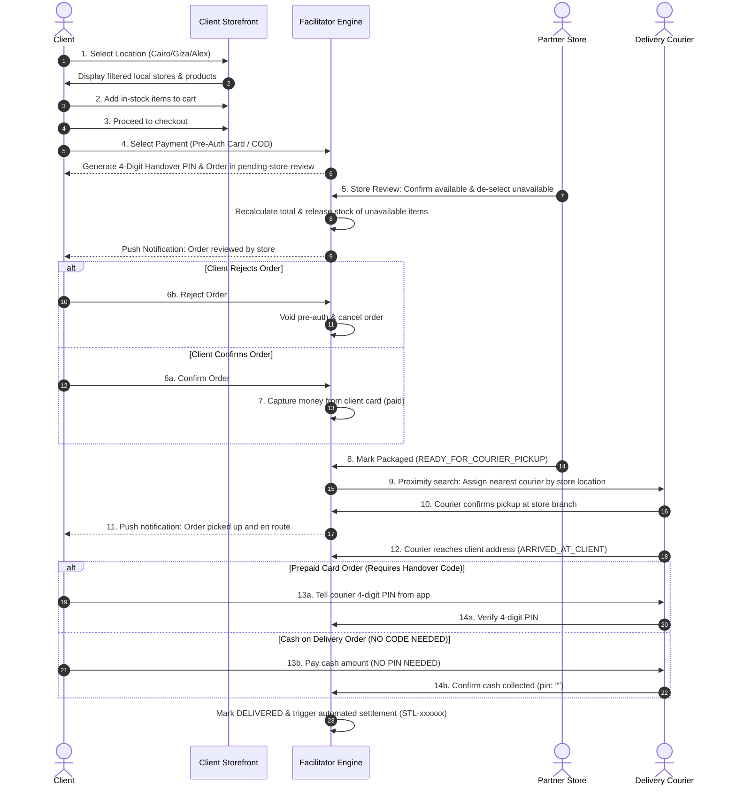

# Business Requirements Document (BRD): Egypt Multi-Store Marketplace Facilitator & Outsourced Delivery Platform

## 1. Executive Summary & Business Model
This Business Requirements Document (BRD) defines the functional, financial, and operational requirements for an **Egyptian Zero-Inventory Multi-Store Marketplace Facilitator** across **Web (Arabic RTL & English)**, **Apple App Store (iOS)**, and **Google Play Store (Android)**.

### Core Business Model Pillars
1. **Zero Platform Inventory Risk:** The platform does **not** own warehouses or hold stock. Instead, **Partner Stores (Merchants)** onboard onto the platform, list their products under standardized **Product Categories**, and manage their own live store inventory.
2. **Client-to-Store Connection & Commission Split:** When a Client places an order (even across multiple Partner Stores in a single cart), the platform calculates the **Platform Facilitator Commission (`8%–12%`)** and the **Net Partner Store Payout (`EGP`)**, processing payments via **Paymob Split / Cards / Meeza / Wallets**, **valU BNPL**, **Fawry 48h Reference Codes**, **InstaPay**, or **Cash on Delivery (COD)**.
3. **14-Step Hyperlocal Fulfillment Lifecycle:** Features a structured 14-step workflow covering location-based store filtering, two-phase card payment (pre-authorization -> store stock review -> client confirmation/rejection -> capture), proximity courier dispatch from local fleets, and secure package handover via **4-digit Handover PIN** for prepaid orders (*In case of Cash on Delivery, no PIN code is needed*).
4. **100% Outsourced Last-Mile Delivery (Store $\rightarrow$ Client):** Delivery is outsourced to Egyptian 3PL couriers (**Bosta / Mylerz** and local proximity courier fleets). Each order automatically splits into **Per-Store Delivery Manifests (`wc_deliveries`)**, instructing the courier to pick up directly from the **Partner Store's branch address** and deliver to the **Client's drop-off address**.
5. **Client Order Monitoring & Historical Closed Archive:** The platform provides clients with full self-service visibility over active in-transit shipments and historical closed orders, 7-stage visual milestone pipelines, courier vehicle details, Bosta waybill numbers, printable tax invoices, and 1-click support desk chat.

---

## 2. System Actors & Dedicated Portals

| Actor | Role & Responsibilities | Dedicated PoC Screen / Interface |
| :--- | :--- | :--- |
| **1. Client (Shopper / Consumer)** | Filters stores by **Shopping Location (Governorate)**, browses by **Product Category**, places multi-store orders, reviews order modifications (accepts/rejects updated item totals), provides **4-digit Handover PIN** to courier upon arrival (or pays COD cash with no PIN needed), monitors active shipments and historical closed archive, prints official tax invoices, and initiates **Live Customer Support Chats (`💬 Chat with Support`)**. | **Tab 1:** `🛒 Client Storefront`<br>**Tab 2:** `📦 My Orders & Tracking (Active & Closed Archive)`<br>**Tab 3:** `📱 iOS & Android Mobile App` |
| **2. Partner Store (Merchant / Vendor)** | Manages store stock by Category, receives incoming orders for stock verification, confirms available items and de-selects non-available items, marks verified packages **"Ready for Courier Pickup"**, and tracks **Net Store Payout (EGP)**. | **Tab 4:** `🏪 Partner Store Portal` |
| **3. Outsourced Delivery Coordinator & Couriers (Bosta / Proximity Fleet)** | Dispatches proximity couriers based on store branch location (`CAIRO`, `GIZA`, `ALEX`), confirms branch pickup, marks arrival at client address, validates **4-digit Handover PIN** for prepaid orders (or collects cash for COD without PIN), and marks packages **DELIVERED**. | **Tab 5:** `🚚 Outsourced Delivery Hub` |
| **4. Marketplace Facilitator Admin (You)** | Has **360° visibility into everything** (All Stores, All Inventory, All Orders, All 3PL Deliveries, All Cash Settlements, All Webhooks), operates the **🎧 Live Customer Support Desk**, and controls **Commercial Rules (Delivery Fee, Egypt VAT %, Commission %, COD Fee, Cash Settlement Cycle)** across **ALL Partner Stores** or a **Specific Partner Store**. | **Tab 6:** `⚙️ Facilitator Control Tower & Webhooks` |

---

## 3. The 14-Step Hyperlocal Fulfillment Lifecycle

The complete e-commerce cycle is governed by a strict 14-step state machine ensuring operational accuracy and financial security:

```
[1. Select Location] -> [2. Add to Cart] -> [3. Checkout] -> [4. Select Payment (Pre-Auth / Hold)]
         |
         v
[5. Store Review: Confirm Available / De-Select Unavailable]
         |
         +----------------------------------+
         |                                  |
   (If Confirmed)                     (If Rejected)
         |                                  |
         v                                  v
[6. Client Confirms]              [6. Client Rejects]
         |                                  |
[7. Money Taken from Card]        [Order Cancelled & Stock Released]
         |
         v
[8. Store Packs Order (READY_FOR_COURIER_PICKUP)]
         |
         v
[9. Proximity Search & Assign Nearest Courier to Store]
         |
         v
[10. Courier Confirms Branch Pickup]
         |
         v
[11. Client Receives Pickup Notification]
         |
         v
[12. Courier Reaches Client Address]
         |
         +----------------------------------+
         |                                  |
   (Prepaid Card)                         (COD)
         |                                  |
         v                                  v
[13. Client Shares 4-Digit PIN]   [13. No PIN Code Needed]
         |                                  |
[14. Courier Verifies PIN]        [14. Courier Collects Cash]
         |                                  |
         +----------------------------------+
         |
         v
[Package Handed Over -> DELIVERED -> Automated Cash Settlement (STL-xxxxxx)]
```

### Detailed Step-by-Step Specifications

1. **Step 1 — Select Location:** Shopper selects their shopping location/governorate (`Cairo`, `Giza`, `Alexandria`, or `All Egypt`). Only partner store branches physically operating in the selected location are displayed in the store selector and catalog.
2. **Step 2 — Add to Cart:** Shopper adds available items to cart from the filtered partner stores. Multi-store cart items calculate per-store sub-manifests and delivery fees.
3. **Step 3 — Checkout:** Shopper enters delivery address and contact details within the selected governorate.
4. **Step 4 — Select Payment Method & Pre-Authorization:**
   * **Prepaid Card / Paymob:** Order is created in `order_status = 'pending-store-review'`, payment is placed in **Pre-Authorization / Hold** (`payment_status = 'pre_authorized'`), and a secure **4-digit Handover PIN** is generated.
   * **Cash on Delivery (COD):** Order is created in `order_status = 'pending-store-review'` with `payment_status = 'pending'`.
5. **Step 5 — Store Availability Review & De-Selection:** Partner store receives the order in the **Partner Store Portal**. The merchant reviews stock:
   * Merchant confirms items that are in stock.
   * Merchant **de-selects non-available items** (marked `OUT_OF_STOCK`).
   * Reserved units for de-selected items are immediately returned to available stock.
   * Order subtotal, VAT, delivery fee, commission, and client total are dynamically recalculated.
   * Order moves to `order_status = 'store-reviewed'`.
6. **Step 6 — Client Review & Decision:** Client receives notification of the verified order and reviews the updated items and revised total in **My Orders**:
   * **Action A (Confirm):** Client approves the updated order to proceed to packaging.
   * **Action B (Reject):** Client rejects the order; the pre-authorization hold is voided with zero charge, all reserved stock is released back to the store, and order is marked `cancelled`.
7. **Step 7 — Payment Capture:** Upon Client confirmation:
   * For Prepaid Cards, the money is officially captured from the client's card (`payment_status = 'paid'`).
   * Order transitions to `order_status = 'ready-to-ship'`.
8. **Step 8 — Store Packaging:** Partner store packs the confirmed items and marks the sub-order `READY_FOR_COURIER_PICKUP`.
9. **Step 9 — Proximity Courier Dispatch:** Platform executes a proximity search against the registered courier fleet based on the partner store's pickup branch governorate, selecting and assigning the nearest available courier (e.g., Tarek Mostafa, 0.8 km from Cairo branch). Delivery status moves to `COURIER_ASSIGNED`.
10. **Step 10 — Courier Branch Pickup:** Courier arrives at the partner store branch and clicks **Confirm Pickup**.
11. **Step 11 — Client Pickup Notification:** System dispatches real-time notification to the client confirming that their order has been picked up from the store and is en route. Delivery moves to `PICKED_UP_FROM_STORE`.
12. **Step 12 — Courier Reaches Client:** Courier arrives at the client's drop-off address and marks arrival (`ARRIVED_AT_CLIENT`).
13. **Step 13 — Handover Code Exchange / COD Handling:**
   * **Prepaid Card Flow:** Client accesses the **My Orders** screen, views their secret **4-digit Handover PIN**, and provides it verbally or visually to the courier.
   * **Cash on Delivery (COD) Flow:** **Crucial Rule:** *In case of cash on delivery, no need for the code.* The courier collects the physical cash amount (`cod_to_collect_egp`).
14. **Step 14 — Handover Verification & Settlement:**
   * **Prepaid Verification:** Courier enters the 4-digit PIN in the Delivery Hub. If correct, handover is confirmed. If incorrect, system rejects handover with HTTP 400.
   * **COD Verification:** Courier confirms receipt of cash with zero PIN required.
   * **Finalization:** Parcel is handed over, delivery marked `DELIVERED`, order marked `completed-settled`, and automated cash settlement (`STL-xxxxxx`) is executed.

---

## 4. Main Business Flowcharts

### Sequence Diagram: The 14-Step E-Commerce Lifecycle



---

## 5. Financial & Commission Split Matrix

| Order Component | Who Pays / Collects | Who Receives It | Example (10,000 EGP Item @ 10% Store Commission + 55 EGP Cairo Delivery) |
| :--- | :--- | :--- | :--- |
| **Product Price Subtotal** | Paid by **Client** | Split between **Partner Store** & **Facilitator** | `10,000 EGP` |
| **Facilitator Commission (`8%–12%`)** | Deducted from Subtotal | **Marketplace Facilitator (You)** | `1,000 EGP` *(Your Net Revenue)* |
| **Net Partner Store Payout** | Settled via Paymob Split / Bank | **Partner Store (Vendor)** | `9,000 EGP` *(Paid to Store)* |
| **Outsourced Delivery Fee** | Paid by **Client** | **3PL Courier (Bosta / Courier Fleet)** | `55 EGP` *(Covers Store-to-Client Delivery)* |

---

## 6. End-to-End Cash Settlement & Commission Realization (`STL-xxxxxx`)
1. **Eligibility Trigger (`ELIGIBLE_FOR_SETTLEMENT`):** A Partner Store sub-order becomes eligible for Cash Settlement only after the courier completes Step 14 (`DELIVERED`).
2. **Prepaid Rail Settlement (`Paymob Split / Fawry / valU / InstaPay`):** Upon `POST /wp-json/wc/v3/deliveries/{id}/verify-handover`, the escrow split releases `net_store_payout_egp` to the Partner Store's account and realizes `platform_commission_egp` into the Facilitator's revenue ledger (`STL-xxxxxx`).
3. **COD Rail Settlement (`Courier COD Remittance -> InstaPay Payout`):** The courier collects `cod_to_collect_egp` cash; the Facilitator deducts its `platform_commission_egp` (`8%–12%`) and transfers `net_store_payout_egp` to the Partner Store via InstaPay Corporate / Bank Payout (`STL-xxxxxx`).
4. **Master Order Closure (`completed-settled`):** Once all Partner Store sub-deliveries for an order reach `SETTLED_TO_STORE`, the parent order automatically transitions to `order_status = 'completed-settled'` and `payment_status = 'settled'`.
5. **Historical Archive Partitioning:** Closed orders are preserved in the Client Order History archive with auditable financial summaries, delivery waybill history, and printable invoices.

---

## 7. Non-Functional & Interactive UX Requirements
* **Eye-Friendly Adaptive Light/Dark Theme (`Plus Jakarta Sans` + `Cairo`):** Defaults to a high-contrast, low-glare **Light Theme** (`#f4f7fb` canvas with pure `#ffffff` cards, generous padding, and `14px` readable typography) with a 1-click **🌙 Dark / ☀️ Light Mode Toggle** in the top header.
* **Hyperlocal Location Selector (`Client Location Bar`):** Prominently docked above category filters on the Client Storefront, enabling one-click switching between Cairo, Giza, Alexandria, and All Egypt.
* **Store Availability Review Panel:** Clear interactive checklist in Partner Store Portal allowing merchants to toggle item availability before packing.
* **Client Confirmation Banner:** High-visibility approval drawer in My Orders for clients to confirm modified orders or reject them with zero penalty.
* **PIN Handover vs. COD Notice Card:** Distinct security card in My Orders displaying the 4-digit PIN for card payments, or an explicit green notification that COD requires NO PIN.
* **Dual-Stack Local & Vercel Cloud Parity:** Fully deployable to Vercel Serverless while maintaining 100% architectural parity with the local environment.
