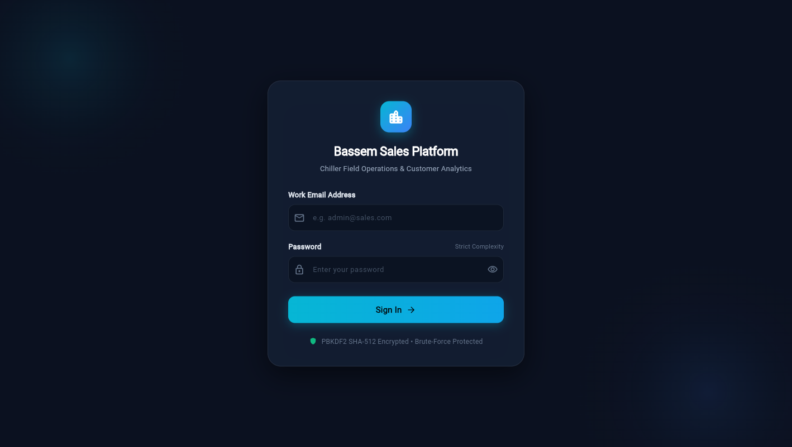

# Bassem Sales Platform — User Guide (`v2.5.0` Baseline + `v2.6.0` Sprint 1 & 2)

**Product Version:** `v2.5.0` (Express API + Flutter Web + Vercel Blob) with `v2.6.0` Sprint 1 & 2 Enhancements  
**Target Audience:** System Owners, Operations Administrators, Area Sales Managers, and Field Sales Agents  
**Last Updated:** 2026-11-19  

---

## Sprint Delivery Snapshot Checklist

> [!NOTE]
> Every sprint updates this guide with newly shipped features and live UI screenshots captured from `http://localhost:5000` into `docs/screenshots/`.

| Screen / Feature | Role Scope | Screenshot File | Status |
| :--- | :--- | :--- | :--- |
| **Login & Security Gate** | Public | [`01_login_screen.png`](screenshots/01_login_screen.png) | [x] Captured live from `http://localhost:5000` |
| **Interactive Geospatial Map** | Owner / Admin / Agent | `docs/screenshots/02_map_view.png` | [ ] Pending authenticated capture |
| **Upload & Validate (Excel/CSV)** | Owner / Admin | `docs/screenshots/03_upload_validate.png` | [ ] Pending authenticated capture |
| **Assign Locations** | Owner / Admin | `docs/screenshots/04_assign_locations.png` | [ ] Pending authenticated capture |
| **Sales Agents Management** | Owner / Admin | `docs/screenshots/05_sales_agents.png` | [ ] Pending authenticated capture |
| **Universal 36+ Column Data Table** | Owner / Admin | `docs/screenshots/06_data_table.png` | [ ] Pending authenticated capture |
| **Forms Manager (Dynamic Builder)** | Owner / Admin | `docs/screenshots/07_forms_manager.png` | [ ] Pending authenticated capture |
| **Visit Responses & Review Monitor** | Owner / Admin | `docs/screenshots/08_visit_responses.png` | [ ] Pending authenticated capture |
| **System Logs & Diagnostics** | Owner Only | `docs/screenshots/09_system_logs.png` | [ ] Pending authenticated capture |
| **Self-Service Change Password Dialog** *(Sprint 1)* | Owner / Admin / Agent | `docs/screenshots/10_change_password.png` | [ ] Pending authenticated capture |
| **Rep KPI Summary Strip & Branch Rollups** *(Sprint 1)* | Owner / Admin / Agent | `docs/screenshots/11_kpi_summary_strip.png` | [ ] Pending authenticated capture |
| **Customer 360 Drawer & NBA Card** *(Sprint 2)* | Owner / Admin / Agent | `docs/screenshots/12_customer_360_drawer.png` | [ ] Pending implementation & capture |
| **Smart Daily Route Planner ("Plan My Day")** *(Sprint 2)* | Agent / Owner / Admin | `docs/screenshots/13_route_planner.png` | [ ] Pending implementation & capture |
| **Theme Switcher & Outdoor Field Contrast Mode** *(UI/UX P4)* | Owner / Admin / Agent | `docs/screenshots/14_theme_outdoor_mode.png` | [ ] Pending implementation & capture |
| **Mobile Thumb-Zone Bottom Navigation** *(UI/UX P4)* | Owner / Admin / Agent | `docs/screenshots/15_mobile_bottom_nav.png` | [ ] Pending implementation & capture |
| **Map Condition Pin Mode & Legend** *(UI/UX P4)* | Owner / Admin / Agent | `docs/screenshots/16_map_condition_pins.png` | [ ] Pending implementation & capture |
| **Drag-and-Drop Upload & Errors-Only Preview** *(UI/UX P4)* | Owner / Admin | `docs/screenshots/17_upload_dropzone_errors.png` | [ ] Pending implementation & capture |
| **Data Table Sticky Pinning, Density & Multi-Sort** *(UI/UX P5)* | Owner / Admin | `docs/screenshots/18_table_pinning_multisort.png` | [ ] Pending implementation & capture |
| **Delta View Before → After Visual Diff Cards** *(UI/UX P5)* | Owner / Admin | `docs/screenshots/19_delta_diff_cards.png` | [ ] Pending implementation & capture |
| **Audit Photo Gallery & Zoomable Lightbox** *(UI/UX P5)* | Owner / Admin / Agent | `docs/screenshots/20_photo_lightbox.png` | [ ] Pending implementation & capture |
| **`EN / عربي` Arabic RTL & WCAG AA Accessibility** *(UI/UX P5)* | Owner / Admin / Agent | `docs/screenshots/21_arabic_rtl_mode.png` | [ ] Pending implementation & capture |

---

## 1. Login & Role-Based Access Control (RBAC)

### 1.1 Signing In
Open the platform in your browser (`http://localhost:5000` locally, or your deployed Vercel URL).

1. Enter your **Work Email Address** (e.g., `admin@sales.com` or your assigned agent email).
2. Enter your **Password** (use the eye icon to toggle visibility).
3. Click **Sign In** (or press `Enter`).

**Security Protections (`v2.5.0`):**
- Passwords are hashed with **PBKDF2 (100,000 iterations, SHA-512)** and unique per-user salts.
- **Brute-Force Protection:** After **5 failed login attempts**, a **5-minute lockout** is enforced per IP and account identifier.
- **Password Management:** Admins can set or reset any agent's password from the **Sales Agents** tab. In addition, any logged-in user (`owner`, `admin`, or `agent`) can rotate their own password using the **Self-Service Change Password** dialog (`STORY-002`, Sprint 1):
  1. Click **Change Password** in the top `AppBar` (desktop) or navigation `Drawer` (mobile `< 768px`).
  2. Enter your **Current Password**, **New Password**, and **Confirm New Password** (using the eye icon to toggle visibility).
  3. Ensure the new password meets complexity rules (**minimum 8 characters**, at least **1 uppercase**, **1 lowercase**, **1 digit**, and **1 special character**) and click **Update Password**.
  4. On confirmation, the new credentials take effect immediately on your next sign-in.

> *[Screenshot Placeholder: Add `docs/screenshots/10_change_password.png` showing the self-service Change Password dialog.]*

### 1.2 Role-Based Navigation (RBAC) & Mobile Thumb-Zone Bar *(UI/UX P4 — `STORY-006`)*
On desktop (`>= 768px`), the left `NavigationRail` adapts automatically to your role. On mobile (`< 768px`), primary actions move into a bottom **`NavigationBar`** in the lower thumb zone:

| Role | Desktop Navigation (`>= 768px`) | Mobile Bottom Bar (`< 768px`) | Data Scope |
| :--- | :--- | :--- | :--- |
| **System Owner (`owner`)** | **8 Tabs:** Map View, Upload & Validate, Assign Locations, Sales Agents, Data Table, Forms Manager, Visit Responses, **System Logs** | **4 Primary Tabs** (`Map`, `Table`, `Assign`, `Responses`) + **`More` Sheet** (`Upload & Validate`, `Sales Agents`, `Forms Manager`, `System Logs`, `Theme Mode`) | Full fleet visibility + audit logs |
| **Admin (`admin`)** | **7 Tabs:** Map View, Upload & Validate, Assign Locations, Sales Agents, Data Table, Forms Manager, Visit Responses | **4 Primary Tabs** (`Map`, `Table`, `Assign`, `Responses`) + **`More` Sheet** (`Upload & Validate`, `Sales Agents`, `Forms Manager`, `Theme Mode`) | Full fleet visibility |
| **Sales Agent (`agent`)** | **1 Tab:** **My Assigned Customers** (Map View) | **3 Ergonomic Tabs:** `My Map`, `My List` (searchable assigned chiller cards), and `Route` (opens Map & toggles Smart Daily Route Mode) | **Strictly isolated** to chillers/accounts assigned to that agent |

> *[Screenshot Placeholder: Add `docs/screenshots/15_mobile_bottom_nav.png` showing the mobile thumb-zone `NavigationBar` and `More` sheet.]*

### 1.3 Theme Switcher & Outdoor Field Contrast Mode *(UI/UX P4 — `STORY-006`)*
Click the **Theme Mode** switcher icon in the top `AppBar` (or inside the mobile `More` sheet) to cycle between three persisted visual modes:
- **Dark Mode (Default):** Deep slate (`#0F172A`) and cyan (`#06B6D4`) workspace optimized for indoor/evening review.
- **Light Mode:** Clean light slate (`#F8FAFC`) surface for bright office environments.
- **Outdoor Field Contrast Mode:** Pure white (`#FFFFFF`) canvas with high-contrast dark ink (`#020617`, `>= 14:1` contrast) and deepened accents (`#0369A1`) engineered for direct sunlight legibility on field routes.

> *[Screenshot Placeholder: Add `docs/screenshots/14_theme_outdoor_mode.png` showing the Theme Switcher and Outdoor Field Contrast mode.]*

### 1.4 `EN / عربي` Arabic RTL Toggle & WCAG AA Accessibility *(UI/UX P5 — `STORY-009`)*
- **Bilingual `EN / عربي` Toggle:** Switch between English (`LTR`) and Arabic (`RTL`) from the top `AppBar` (desktop) or mobile `More` sheet (`Locale('en')` / `Locale('ar')` with `flutter_localizations`).
- **Directional Layout & LTR Data Protection:** Directional spacing, alignments, borders, and navigation icons mirror automatically in Arabic mode, while **Chiller Codes** (e.g., `CH-1042`), **GPS coordinates**, and **numeric KPIs** (e.g., `-12.4%`) remain locked to `TextDirection.ltr` so values never reverse.
- **WCAG AA Accessibility & Ergonomics:**
  - All mobile icon buttons, map pins, and filter chips enforce a minimum **`44x44` touch target**, with screen-reader `Semantics` labels on interactive controls.
  - Full keyboard **`Tab` focus rings** and **`Esc` dismissal** for drawers and lightbox modals.
  - **Unified Toasts & Inline Form Validation:** Floating `AppToast` notifications (`success`, `info`, `warning`, `error`) and inline field validation (`AutovalidateMode.onUserInteraction`, `#EF4444` error borders, and auto-scroll to the first invalid field on submit).

> *[Screenshot Placeholder: Add `docs/screenshots/21_arabic_rtl_mode.png` showing Arabic RTL layout mode and WCAG AA accessibility controls.]*

---

## 2. Excel / CSV Ingestion & Batch History

**Tab:** `Upload & Validate` *(Owner & Admin only)*

### 2.1 Uploading a Master Sheet *(UI/UX P4 — `STORY-007`)*
1. **Drag & Drop or Browse:** Drag a `.xlsx`, `.xls`, or `.csv` file (up to **25 MB**) onto the interactive **Dropzone** (or click to browse files / use **Quick Load Sample Excel**). The dropzone highlights cyan on drag-over, green on valid drop, and red if an unsupported extension is dropped.
2. **Staged Upload & Validation Preview:** The platform tracks progress (`1. Uploading` → `2. Validating Columns` → `3. Ready for UPSERT`) via `POST /api/excel/parse`, extracts all **36+ dynamic FMCG columns** (e.g., `Branch`, `Chiller Code`, `Condition`, `Jan–Dec Invoice`, `YTD`, `Month Ach. Status`, GPS coordinates), and displays the 4 validation summary cards (`Uploaded File`, `Total Rows`, `Valid Rows`, `Incomplete / Missing`).
3. **Errors-Only Preview Filter:** Use the **`All Rows` | `Errors Only`** toggle above the preview table to immediately isolate failing or incomplete rows before choosing strict vs. bypassed save and clicking **Confirm Ingestion** (`POST /api/excel/confirm`).

> *[Screenshot Placeholder: Add `docs/screenshots/17_upload_dropzone_errors.png` showing the Drag-and-Drop Upload Dropzone and Errors-Only validation preview.]*

### 2.2 Data Safety & Batch Immutability
- **Incremental `UPSERT` Mode Only:** All uploads in `v2.5.0` perform an incremental `UPSERT` (`onlyThisBatch: false`) so existing chiller records and assignments are never accidentally wiped by a partial sheet.
- **DDE / Formula Injection Protection:** Leading formula characters (`=`, `+`, `-`, `@`) are neutralized during ingestion to prevent spreadsheet execution exploits.
- **Immutable Batch History:** Every confirmed upload creates an immutable historical batch snapshot. Individual batch deletion (`DELETE /api/batches/:id`) is permanently disabled (`403 Forbidden`) to preserve audit integrity. Full dataset resets are restricted to `admin`/`owner` via `POST /api/admin/clear-all-batches`.

> *[Screenshot Placeholder: Add `docs/screenshots/03_upload_validate.png` showing the Upload & Validate preview screen.]*

### 2.3 Delta View `Before → After` Visual Diff Cards *(UI/UX P5 — `STORY-008`)*
When comparing batch updates in the **Delta View**, changes are presented as structured **Visual Diff Cards** instead of raw text tables:
- **Card Header:** Displays `Chiller Code`, `Customer Name`, and a color-coded Change Type pill (`Added`, `Removed`, or `Modified`).
- **Side-by-Side `Before → After` Field Diff Pills:** Highlights changes across `Condition` (e.g., `Operational → Requires Maintenance`), `Efficiency` (`Non-Performing → Performing`), and numeric `YTD Invoice` deltas (amount and `%`).
- **Quick Action:** Click **Open 360°** on any diff card to open the **Customer 360 Drawer** and inspect the chiller's full history.

> *[Screenshot Placeholder: Add `docs/screenshots/19_delta_diff_cards.png` showing the Delta View Before → After Visual Diff Cards.]*

---

## 3. Interactive Geospatial Map

**Tab:** `Map View` *(Owner/Admin)* / `My Assigned Customers` *(Sales Agent)*

The interactive **OpenStreetMap / Leaflet** canvas plots every chiller with valid GPS coordinates:
- **Pin Color Mode Toggle (`Efficiency` | `Condition`) *(UI/UX P4 — `STORY-007`)*:** Switch the top-left map control between **Efficiency** (`Performing` / `Non-Performing` / `Zero`) and **Condition** mode. In **Condition** mode, pins use dual-signal color + inner icons (`Operational` = Emerald check, `Requires Maintenance` = Orange wrench/build, `Scrap` = Rose red danger, `Unspecified` = Slate `?`), the floating legend updates dynamically, and a quick **Condition** filter chip isolates maintenance/scrap chillers in one tap.
- **Visit Completion State:** Pins dynamically turn **Green** once a field visit audit form is submitted for that chiller.
- **My Location:** Click **My Location** to center the map on your current browser GPS position and inspect nearby retail outlets.
- **Map Canvas Controls:** Use the minimize/maximize toggle controls to expand the map for full-screen territory review or collapse it when focusing on tabular details.
- **Pin Details & Actions:** Click any marker pin to inspect the customer/chiller details, open directions, or launch an assigned **Visit Audit Form**.

> *[Screenshot Placeholder: Add `docs/screenshots/02_map_view.png` showing the interactive Leaflet map with colored chiller pins, and `docs/screenshots/16_map_condition_pins.png` showing Condition Pin Mode and its dynamic legend.]*

### 3.1 Rep KPI Summary Strip & Branch Rollups *(Sprint 1 — `STORY-003`)*
Positioned at the top of the Map / Data Table workspace (horizontal cards on desktop, compact 2x2 grid on mobile `< 768px`), the **Rep KPI Summary Strip** provides live execution metrics:
- **Sales Agent View (`agent`):** Strictly scoped to your assigned chillers:
  - **Assigned Chillers:** Total chillers assigned to your territory.
  - **Visited This Month:** Count and `%` of assigned chillers with a submitted visit audit in the current calendar month.
  - **Pending Audits:** Assigned chillers with no visit this month or a `Re-opened` audit status.
  - **Avg Achievement %:** Mean monthly/YTD achievement across your assigned chillers.
- **Admin / Owner View (`admin` | `owner`):** Displays fleet-wide totals for the same 4 KPIs plus a **Branch Target Rollup** selector/popover grouped by `Branch`.
- **Interactive Filtering:** Click **Visited This Month** or **Pending Audits** to filter the active Map / Data Table view to matching chillers (click the active-filter chip to reset).

> *[Screenshot Placeholder: Add `docs/screenshots/11_kpi_summary_strip.png` showing the Rep KPI Summary Strip and Branch Rollup popover.]*

### 3.2 Customer 360 Drawer & Next Best Action (NBA) Card *(Sprint 2 — `STORY-004`)*
Clicking any chiller pin on the map (or any row in the `Data Table` for `admin`/`owner`) opens the **Customer 360 Drawer** (slide-over panel on desktop, bottom sheet on mobile):
- **Asset Profile:** Outlet/Customer Name, `Chiller Code`, `Branch`, `Condition`, `Month Ach. Status`, serial metadata, and assigned agent.
- **Financial Velocity:** 12-month (`Jan–Dec`) invoice sparkline trendline, `YTD` total, and month-over-month (MoM) delta `%`.
- **Next Best Action (NBA) Guided Selling Card:** Rule-based prompt prioritizing the highest-value action for the store (e.g., *Log Service / Maintenance Ticket* if `Requires Maintenance`/`Damaged`; *Pitch Restock / Promo* if MoM invoice dropped `> 20%`; *Complete Monthly Visit Audit* if unvisited/re-opened; or *Reinforce Relationship & Check POSM*).
- **Visit History & Quick Actions:** Chronological past audit responses with photo thumbnails, plus one-tap **Start / Open Audit Form** and **Get Directions**.

> *[Screenshot Placeholder: Add `docs/screenshots/12_customer_360_drawer.png` showing the Customer 360 Drawer with Jan–Dec sparkline and NBA card.]*

### 3.3 Smart Daily Route Planner ("Plan My Day") *(Sprint 2 — `STORY-005`)*
Click **Plan My Day** on the `Map View` / `My Assigned Customers` toolbar to sequence your daily store visits:
1. **Priority & Proximity Sequencing:** Automatically filters assigned chillers with valid GPS coordinates, prioritizes urgent stops (unvisited this month, `Re-opened` audits, `Requires Maintenance`, or underperforming), and orders them by shortest path from your current GPS location (or territory centroid if geolocation is unavailable).
2. **Interactive Stop Selection:** Toggle individual chillers in or out of today's route (default up to 10 stops, max 25) and view updated total estimated distance (`km`). Chillers missing GPS coordinates are clearly reported as excluded.
3. **Map Polyline & Google Maps Handoff:** Displays numbered route pins (`1, 2, 3...`) connected by a polyline on the map. Click **Start Navigation (Google Maps)** for multi-stop turn-by-turn directions, or click **Navigate** on any individual stop.

> *[Screenshot Placeholder: Add `docs/screenshots/13_route_planner.png` showing the Smart Daily Route Planner panel and numbered map polyline.]*

---

## 4. Universal 36+ Column Data Table & Search

**Tab:** `Data Table` *(Owner & Admin only)*

1. **Universal Omni-Search:** Type any keyword (chiller code, customer name, branch, serial number, phone, etc.) into the global search bar to filter across all **36+ columns** simultaneously.
2. **Per-Column Interactive Filters:** Click any column header filter icon to open a filter dialog featuring:
   - Text search within that column.
   - **Value-Frequency Chips** displaying distinct values and their occurrence counts.
3. **Sticky Left Column Pinning *(UI/UX P5 — `STORY-008`)*:** `360° Action + Chiller Code + Customer Name` (configurable via the **Pin** icon in Column Visibility) stay frozen on the left with a `2px` cyan boundary while you scroll horizontally across the remaining 36+ columns, synchronized vertically.
4. **Row Density Toggle *(UI/UX P5 — `STORY-008`)*:** Use the segmented toolbar toggle to switch between **`Compact`** (`36px` row height, `12px` font), **`Standard`** (`48px`, `13px`), and **`Comfortable`** (`60px`, `13.5px` with wrapped address); your preference persists across sessions.
5. **3-Level Multi-Sort *(UI/UX P5 — `STORY-008`)*:** Click a column header to set/toggle the primary sort, and use **`Shift + Click`** (desktop) or **`+ Sort`** in the column header menu (mobile/touch) to stack up to **3 sort levels** (`Primary`, `Secondary`, `Tertiary`) with numeric-aware sorting for `Jan–Dec` and `YTD`. Sorted headers show numbered badges (`1 ↑`, `2 ↓`) alongside a dismissible active-sort chip bar above the table.

> *[Screenshot Placeholder: Add `docs/screenshots/06_data_table.png` showing the 36+ column Data Table with omni-search and column filter chips, and `docs/screenshots/18_table_pinning_multisort.png` showing sticky column pinning, Row Density toggle, and 3-level Multi-Sort.]*

---

## 5. Territory Assignments & Sales Agent Management

### 5.1 Managing Sales Agents (`Sales Agents` Tab)
*(Owner & Admin only)*
- **Create / Edit / Delete Agents:** Maintain each representative's name, assigned **Territory / Area**, phone number, and login email.
- **Set / Reset Login Password:** Click the key/password action (`Set / Reset Login Password`) on an agent card to provision or rotate their login credentials (enforcing strict password complexity).
- **Assigned Count Badge:** Each agent card displays their current `assigned_count` of chillers.

> *[Screenshot Placeholder: Add `docs/screenshots/05_sales_agents.png` showing the Sales Agents directory and password reset actions.]*

### 5.2 Assigning Locations (`Assign Locations` Tab)
*(Owner & Admin only)*
1. Filter the paginated location list by **All**, **Assigned Only**, or **Unassigned** accounts, or search by customer/chiller code.
2. **Single Assignment:** Click **Assign Agent** (or **Reassign**) on any row, choose the target sales agent, and confirm. Click the unassign icon to remove an assignment.
3. **Bulk Assignment:** Check multiple rows and click **Assign Selected (N)** to assign an entire batch of locations to a sales agent in one operation.

> *[Screenshot Placeholder: Add `docs/screenshots/04_assign_locations.png` showing the Assign Locations table and bulk selection.]*

---

## 6. Dynamic Form Builder & Field Visit Audits

### 6.1 Creating Audit Forms (`Forms Manager` Tab)
*(Owner & Admin only)*
1. Create custom visit audit forms with any combination of field types:
   - **`text`**: Short or multi-line observations, serial number checks, or numeric readings (e.g., chiller temperature).
   - **`choose`**: Single-select dropdowns/chips (e.g., hygiene rating, operational condition).
   - **`attachments`**: Camera/photo or file uploads (e.g., chiller front and condition photos).
2. Assign each form **globally** to all sales agents or **individually** to selected agents.

> *[Screenshot Placeholder: Add `docs/screenshots/07_forms_manager.png` showing the Dynamic Form Builder.]*

### 6.2 Submitting a Field Visit (Sales Agent Map)
1. On the **My Assigned Customers** map, tap an assigned chiller pin.
2. Open the assigned audit form, complete all required fields, attach on-site photos, and click **Submit**.
3. Upon submission, the chiller pin updates to a **Green completed visit state**.

### 6.3 Reviewing Visits (`Visit Responses` Tab) & Audit Photo Lightbox *(UI/UX P5 — `STORY-009`)*
*(Owner & Admin only)*
- Inspect all submitted field visit audits, including form answers and uploaded photo attachments.
- **Audit Photo Gallery:** Both `Visit Responses` (`4-column` grid) and the `Customer 360 Drawer` (`3-column` grid) render `80x80` rounded thumbnails with `Photo N/M`, timestamp, and `GPS Verified` dot badges, plus shimmer loading and graceful `Image unavailable` fallback states.
- **Zoomable Lightbox (`1x–4x`):** Tap any photo thumbnail to open the full-screen dark-scrim lightbox featuring pinch/scroll zoom (`1x–4x`), Left/Right keyboard and swipe navigation, a metadata footer (Rep, Chiller Code, Audit Date, Condition), `Esc` to close, and a **Download** button.
- **Approve** verified visits or **Re-open** an audit with review feedback so the field agent can correct and resubmit.

> *[Screenshot Placeholder: Add `docs/screenshots/08_visit_responses.png` showing the Visit Responses & Review Monitor, and `docs/screenshots/20_photo_lightbox.png` showing the Audit Photo Gallery and zoomable Lightbox.]*

---

## 7. System Logs & Admin Diagnostics

### 7.1 System Logs (`System Logs` Tab — Owner Only)
- View platform-wide audit events (logins, uploads, assignments, password resets, visit approvals).
- Export audit logs as a timestamped JSON file (`audit_logs_<timestamp>.json`).

> *[Screenshot Placeholder: Add `docs/screenshots/09_system_logs.png` showing the Owner-only System Logs view.]*

### 7.2 Health & Diagnostics API Endpoints
- **Public Health Check (`GET /api/health`):** Sanitized endpoint returning only `status`, `version` (`2.5.0`), `storage` summary (`type`, `cloudSync`, `lastSync`, `chillersCount`, `batchesCount`, `blobConfigured`), and `timestamp`. No user emails, roles, salts, or token prefixes are exposed.
- **Admin Diagnostics (`GET /api/admin/diagnostics`):** Protected by `requireAdmin` Bearer authentication. Returns storage details (including `hasBlobToken` boolean), `usersCount`, and non-sensitive user directory metadata (`email`, `role`, `name`, `username`).
