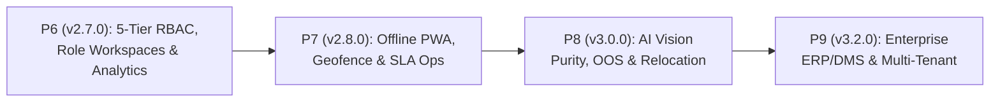
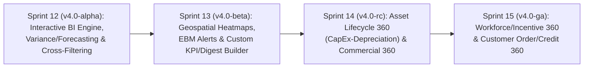

# Product Vision & Roadmap — Bassem Sales Platform

**Owner:** Product Owner (PO)  
**Baseline:** `v2.6.8` (`P1`–`P5` Complete & Live-QA Verified on `:5000`; Modular Express API + Flutter Web + Vercel Blob)  
**Reference:** [../../docs/BRD.md](../../docs/BRD.md) | [../BOARD.md](../BOARD.md) | [COMPETITIVE_BENCHMARK.md](./COMPETITIVE_BENCHMARK.md)  
**Last Updated:** 2026-11-19

---

## 1. North Star Vision & 5-Tier FMCG Sales Hierarchy

### 1.1 North Star Vision
> **Turn every commercial chiller into a high-performing revenue engine and every field action into a role-tailored, data-backed workflow—making Bassem Sales Platform the #1 FMCG Field Sales & Asset Intelligence Platform.**

FMCG distributors lose millions annually to idle or underperforming coolers, fragmented Excel workflows, generic one-size-fits-all screens, and delayed maintenance turnaround. Bassem Sales Platform eliminates that gap by uniting **role-tailored operational workspaces**, **centralized real-time analytics**, **geospatial asset intelligence**, and **closed-loop field & service execution** in one secure command center.

### 1.2 Realistic 5-Tier FMCG Sales & Asset Hierarchy

To mirror real-world FMCG distribution operations, the platform evolves from a 2-role (`admin` / `agent`) model into a **5-tier Role-Based Access Control (RBAC)** hierarchy (preserving `admin` as a backward-compatible alias for `regional_manager`):

| Tier | Role Key | Title | Operational Scope | Primary Mission |
| :--- | :--- | :--- | :--- | :--- |
| **1** | `owner` | **VP / Executive Owner** | National / All Branches | Capital ROI, national YTD vs. Target attainment, branch benchmarking, and strategic fleet health. |
| **2** | `regional_manager` *(alias: `admin`)* | **Regional / Multi-Branch Manager** | Assigned Region / Multi-Branch | Master Excel ingestion & batch delta auditing, cross-branch target tracking, form governance, and user/role administration. |
| **3** | `supervisor` | **Branch / Team Lead** | Single Branch / Assigned Team | Daily visit audit review (Approve / Re-open), SLA compliance, branch rep coaching, and local territory balancing. |
| **4** | `agent` | **Field Sales Rep** *(e.g., Omnia)* | Assigned Store Accounts | Guided **"My Day"** store route, quick on-site chiller audits, photo capture, and personal sales/visit target attainment. |
| **5** | `technician` | **Asset Maintenance / Service Tech** | Assigned Maintenance & Scrap Queue | Triaging `Requires Maintenance` & `Scrap` chillers, executing field repairs, logging parts/notes, and digital repair sign-offs. |

### 1.3 Value Proposition by Role

| Role | Why They Love Bassem Sales Platform | Core Business Outcome |
| :--- | :--- | :--- |
| **`owner`** | Opens an Executive Command Center showing national YTD vs. Target %, Branch Leaderboards, and Top/Bottom chiller ROI in seconds. | **>40% higher asset utilization** and data-driven capital redeployment. |
| **`regional_manager`** | Ingests master spreadsheets with instant delta diffs, governs dynamic audit forms, and tracks multi-branch SLA and revenue pacing. | **Zero spreadsheet version chaos** and 100% cross-branch visibility. |
| **`supervisor`** | Reviews rep visit audits in a dedicated SLA queue with lightbox photo inspection and rebalances branch chillers in clicks. | **50% faster audit turnaround** and balanced rep workloads. |
| **`agent`** | Lands directly on **"My Day"**—a clean mobile route of *only* their assigned stores with 1-tap directions, quick audit forms, and live KPIs. | **+25–35% more store visits/day** and zero cross-territory clutter. |
| **`technician`** | Works from a focused Service & Scrap Queue with SLA timers, GPS routing to broken units, and instant digital repair sign-off. | **40% faster chiller Mean Time to Repair (MTTR)** and fewer lost assets. |

---

## 2. Current Foundation (`P1`–`P5` Delivered: `v2.6.8`)

The platform has a production-hardened, live-QA-verified foundation (`67/67` live assertions passed, `0` console/HTTP errors):

1. **Modular Backend & Enterprise Security (`P3` / `ADR-001`, `ADR-005`)**: Decomposed Express API (`api/routes/`, `api/services/`, `api/middleware/`, `api/utils/`), PBKDF2 (100k SHA-512), timing-safe comparisons, dual rate-limiting brute-force defense, OWASP headers, `CORS_ORIGINS` allowlist, and Change Password UI (`STORY-002`).
2. **Multi-Batch Spreadsheet Ingestion & Delta Auditing**: Parses `.xlsx`, `.xls`, and `.csv` up to 25MB across 36+ dynamic FMCG columns with DDE formula-injection neutralization, drag-and-drop `Errors Only` preview, and `Before → After` Batch Delta cards.
3. **Interactive Geospatial & Table Intelligence**: OpenStreetMap/Leaflet map with `Efficiency | Condition` pin coloring, live GPS `"My Location"`, sticky-pinned Data Table with 3-level multi-sort, density toggle, and compound value-frequency filters.
4. **Dynamic Form Builder & Visual Audit Review**: Configurable audit forms (`text`, `choose`, `attachments`) integrated into map pins, turning pins green on submission, plus `AuditPhotoGallery` 1x–4x zoom lightbox.
5. **Field-First Design System & Localization (`P4`–`P5`)**: `app_tokens.dart` (Dark / Light / Outdoor High-Contrast Field Mode), mobile thumb-zone `NavigationBar`, `AppSkeleton`/`AppEmptyState`/`AppToast`, and `EN / عربي` RTL support with WCAG AA readiness.
6. **Field Execution Accelerators**: Rep KPI Summary Strip (`ROAD-04`), Customer 360 Drawer with Jan–Dec sparkline & Next Best Action (`ROAD-02`), and Smart Daily Route Planner (`ROAD-03`).

---

## 3. Role Features, Permissions & Tailored Workspaces

### 3.1 Role-Based Permissions Matrix (Daily Work Capabilities)

| Capability / Module | `owner` | `regional_manager` (`admin`) | `supervisor` | `agent` | `technician` |
| :--- | :---: | :---: | :---: | :---: | :---: |
| **Data Visibility Scope** | National (All) | Assigned Branches / All | Single Branch | Own Assigned Accounts | Maintenance / Scrap Queue |
| **Central Analytics & KPIs** | National + Branch Leaderboard | Multi-Branch + Target Tracking | Branch + Rep Leaderboard | Personal YTD & Visit Strip | Service SLA & MTTR Strip |
| **Master Excel Upload & Batch Delta** | View Summaries | Full Upload + Confirm + Diff | View Branch Deltas | — | — |
| **Territory & Agent Assignment** | View All | Cross-Branch Assign / Reassign | Balance Branch Territories | — | — |
| **User & Role Management** | Full Governance | Manage Branch/Field Users | View Branch Team | — | — |
| **Dynamic Form Builder** | View | Create / Edit / Assign Forms | Request / View | — | — |
| **Field Visit Execution ("My Day")** | — | — | Optional Spot-Check | Guided Route + Quick Audit | — |
| **Visit Audit Review (Approve/Re-open)** | Escalations | Multi-Branch Review | Primary Daily Queue | View Own Feedback | — |
| **Maintenance / Scrap Queue & Sign-off** | View Fleet Health | Escalations & Scrap Approval | Flag / Monitor Branch | Flag Issue During Visit | Execute Repair + Sign-off |

### 3.2 Role-Tailored UI/UX Landing Workspaces

Every user lands on a **purpose-built, high-clarity workspace** tailored to their daily job—never a generic table dump:

1. **`owner` → Executive Command Center**:
   - **Hero Strip:** National YTD Revenue vs. Target %, Active Fleet Utilization %, Capital at Risk (Inactive/Scrap value).
   - **Core Panels:** Interactive Branch Leaderboard (sortable by Attainment %, Coverage %, Efficiency %), Asset Condition & Efficiency distribution charts, and Top 10 / Bottom 10 Performing Chillers.
2. **`regional_manager` (`admin`) → Regional Operations Console**:
   - **Hero Strip:** Multi-Branch Target Pacing, Latest Batch Delta summary (`+Added / -Eliminated / ~Modified`), and Escalated Audit SLA count.
   - **Core Panels:** Branch Comparison cards, quick-launch Excel Batch Ingestion & Delta Diffs, Dynamic Form Builder, and Cross-Branch Territory & User Governance.
3. **`supervisor` → Branch Team Lead Hub**:
   - **Hero Strip:** Branch YTD vs. Target %, Pending Visit Audit Reviews (with SLA aging badges), and Today's Active Reps in Field.
   - **Core Panels:** **Visit Audit Review Queue** (1-click Approve / Re-open with `AuditPhotoGallery`), Branch Rep Coverage Leaderboard, and Map/Table Territory Balancer to reassign accounts between branch reps.
4. **`agent` → "My Day" Field Execution Workspace**:
   - **Hero Strip:** Personal YTD Attainment %, Today's Route Progress (`X / Y` stops completed), and Pending Re-opened Audits.
   - **Core Panels:** **"My Day" Guided Route** (sequenced by proximity & urgency with 1-tap Google Maps handoff), Map + Bottom-Sheet pin preview, Quick Audit Form submission, and Customer 360 Drawer.
5. **`technician` → Service & Maintenance Dispatch Workspace**:
   - **Hero Strip:** Open Maintenance Tickets, SLA Breaching Soon (`<24h`), and Units Repaired This Week.
   - **Core Panels:** Prioritized **Maintenance & Scrap Queue** (`Open → Dispatched → In Progress → Resolved`), Map view of broken/scrap chillers, Repair Log & Parts checklist, and **Digital Repair Sign-Off** (photo + updated condition verification).

---

## 4. Central Analytics & Dashboard Numbers

Rich, role-scoped analytics are promoted to the center of the platform experience—turning raw 36-column chiller spreadsheets and field audits into actionable numbers:

1. **YTD vs. Target %**:
   - Live aggregation of `YTD` invoice revenue against branch/rep targets, with pace status (`On Track ≥95%`, `At Risk 80–94%`, `Behind <80%`) and Jan–Dec monthly trajectory.
2. **Branch Leaderboard**:
   - Ranked comparison across branches on **YTD Attainment %**, **Visit Audit Completion %**, **Chiller Performing %**, and **Avg. Audit SLA Time**.
3. **Asset Condition & Efficiency Distribution**:
   - Visual breakdown of the fleet across `Condition` (`Good`, `Fair`, `Poor`, `Scrap`) and `Month Ach. Status` (`Performing` vs. `Underperforming`), with 1-click drill-down to filtered map pins and table rows.
4. **Visit Audit SLA & Review Queue**:
   - Real-time operational funnel: `Submitted Today` → `Pending Review` → `Approved` vs. `Re-opened` → `SLA Breached (>24h)`, ensuring zero field audits sit unreviewed.
5. **Top & Bottom Performing Chillers**:
   - Side-by-side spotlight of **Top 10 Revenue Chillers** (protect & replicate) and **Bottom 10 "Ghost / At-Risk" Chillers** (`Condition = Good` with near-zero YTD, or high-value outlets with `Maintenance/Scrap` flags) for immediate supervisor or technician action.

---

## 5. Key Differentiators to Become #1

1. **5-Tier Role-Tailored Workspaces**: Zero generic clutter—every persona from VP (`owner`) to `technician` sees only the KPIs, queues, and actions that drive their daily work.
2. **Centralized, Drill-Down Asset Analytics**: Real-time YTD pacing, Branch Leaderboards, Audit SLAs, and Top/Bottom chiller spotlights wired directly to map & table filters.
3. **Closed-Loop Field & Service Execution**: Seamless handoff from `agent` audit flag → `supervisor` review → `technician` repair sign-off → `owner` fleet ROI recovery.
4. **Offline-First Mobile / PWA Field Mode**: Local IndexedDB queue for zero-signal retail backrooms, 100m GPS check-in geofencing, and geo-stamped photo watermarking.
5. **AI-Powered Chiller & Retail Execution Intelligence**: Computer-vision "Purity" (competitor intrusion), OOS & POSM checks, and predictive chiller relocation recommendations.
6. **Enterprise Ecosystem & Multi-Tenant Scale**: Scheduled ERP/DMS/WhatsApp sync and multi-tenant PostgreSQL/PostGIS isolation.

---

## 6. Refocused Phased Product Roadmap (`P6`–`P9`)

### Phase 6 (`P6` / `v2.7.0`) — 5-Tier RBAC, Role-Tailored Workspaces & Central Analytics *(Next Sprint Focus)*
- **Objective:** Transform the platform from a 2-role tool into a true 5-tier FMCG sales & asset operations suite with role-tailored landing workspaces and central analytics dashboards.
- **Key Deliverables:**
  - **5-Tier RBAC & Auth Model (`RBAC-01`):** Support `owner`, `regional_manager` (backward-compatible with `admin`), `supervisor`, `agent`, and `technician` in JWT claims, API middleware, and branch/queue scoping.
  - **Central Analytics API & Dashboard Engine (`DASH-01..05`):** Backend aggregation endpoints and interactive Flutter widgets for **YTD vs. Target %**, **Branch Leaderboard**, **Asset Condition & Efficiency Distribution**, **Visit Audit SLA/Review Queue**, and **Top/Bottom Performing Chillers**.
  - **Role-Tailored Landing Workspaces (`UX-10..14`):** Dedicated landing views and navigation shells for Executive Command Center (`owner`), Regional Ops Console (`regional_manager`), Branch Team Lead Hub (`supervisor`), "My Day" Field Workspace (`agent`), and Service Dispatch Queue (`technician`).
  - **Supervisor & Technician Daily Workflows (`OPS-10..12`):** Supervisor Visit Audit Approve/Re-open queue + Branch Territory Balancer; Technician Maintenance/Scrap Queue + Repair Log & Digital Sign-Off.
- **Measurable Success Metrics:**
  - **100% role-scoped data isolation** across all 5 tiers (verified by automated RBAC regression tests).
  - **<300ms** analytics aggregation response time for dashboards up to 10,000 chillers.
  - **<3 taps** from login to primary daily action for every role (`agent` route start, `supervisor` audit review, `technician` repair sign-off).

### Phase 7 (`P7` / `v2.8.0`) — Offline-First Field Resilience, Geofencing & SLA Gamification
- **Objective:** Guarantee zero lost field data in cellular dead zones, enforce physical visit authenticity, and automate SLA escalations & rep engagement.
- **Key Deliverables:**
  - **Offline-First PWA & Local Sync Queue (`ROAD-05`):** Service Worker + IndexedDB caching of assigned chillers, "My Day" route, and technician repair queue with conflict-safe auto-sync on reconnect.
  - **100m GPS Check-In Geofencing (`ROAD-11`) & Photo Watermarking:** Verify `agent` and `technician` proximity within 100m on check-in and overlay Chiller Code, GPS, user ID, and timestamp on audit/repair photos.
  - **Automated Maintenance/Scrap SLA Timers (`ROAD-06`):** Auto-escalate overdue tickets (`>24h` / `>48h`) to `supervisor` and `regional_manager` queues.
  - **"Perfect Chiller" Scorecards (`ROAD-07`), Streaks & Map-Lasso Reassignment:** Composite store scorecards, rep visit streaks, and polygon map-lasso bulk territory rebalancing for Supervisors.
  - **1-Click Visual Audit & Fleet PDF Export:** Branded executive/branch PDF report with KPIs and watermarked photos.
- **Measurable Success Metrics:**
  - **0% lost field audits/repairs** in offline zones (`100%` queue sync recovery).
  - **>=95% verified on-site check-ins** within 100m geofence.
  - **40% faster** chiller MTTR and **80% faster** supervisor territory rebalancing.

### Phase 8 (`P8` / `v3.0.0`) — AI Chiller & Retail Execution Intelligence
- **Objective:** Turn field photos and YTD sales history into automated compliance scoring and predictive revenue-uplift actions.
- **Key Deliverables:**
  - **AI Chiller "Purity" Competitor Detection (`ROAD-09`):** Computer-vision analysis of audit photos to detect competitor products and calculate shelf-purity %.
  - **OOS & POSM Compliance:** Automated detection of Out-of-Stock shelves, missing branding stickers, and blurry photo rejection at capture time.
  - **Predictive Chiller Relocation Engine (`ROAD-08`):** Identify low-ROI "Ghost" chillers (`Condition = Good` with low/declining YTD) and recommend high-potential nearby outlets.
- **Measurable Success Metrics:**
  - **>=85% precision/recall** on automated Purity, OOS, and POSM classification.
  - **>40% fleet ROI uplift** on relocated chillers within 90 days.
  - **70% reduction** in manual supervisor photo-review workload.

### Phase 9 (`P9` / `v3.2.0`) — Enterprise Ecosystem, ERP/DMS & Multi-Tenant Scale
- **Objective:** Connect Bassem Sales Platform to distributor ERP/DMS systems and scale to multi-organization enterprise deployments.
- **Key Deliverables:**
  - **Scheduled ERP / DMS API & Webhook Sync (`ROAD-10`):** Bidirectional sync for invoices, stock, and restock triggers while preserving immutable Batch Delta snapshots.
  - **WhatsApp & Push Alert Automation:** Automated SLA breach alerts, audit re-open notifications, and morning "My Day" briefings.
  - **Executive ROI & Fleet Depreciation Console:** Chiller payback period, maintenance cost-to-serve vs. YTD revenue, and branch asset health index.
  - **Multi-Tenant Organization Isolation (PostgreSQL + PostGIS, `ADR-002`):** Full tenant-scoped partitioning, custom branding, and enterprise SSO.
- **Measurable Success Metrics:**
  - **99.9% scheduled ERP sync reliability** with zero manual Excel bottlenecks.
  - **<15 minute** SLA breach alert-to-acknowledgment via WhatsApp/push.
  - **100% tenant data isolation** across enterprise deployments.

---

## 7. Prioritized Enhancement Backlog (`P6`–`P9` Handoff Matrix)

| Phase | Target Release | ID | Initiative | Lead Squad | Primary Business Outcome |
| :--- | :--- | :--- | :--- | :--- | :--- |
| **P6** | `v2.7.0` | `RBAC-01`, `DASH-01..05`, `UX-10..14`, `OPS-10..12` | 5-Tier Sales Hierarchy, Central Analytics Engine, Role-Tailored Workspaces, Supervisor Review & Tech Repair Sign-off | PO + BA + SA + UI/UX + Dev + QA | Role-focused daily clarity, central KPI visibility & closed-loop maintenance |
| **P7** | `v2.8.0` | `ROAD-05..07`, `ROAD-11` | Offline-First PWA Queue, 100m Geofencing, Watermarked Photos, SLA Escalation, Map-Lasso & Audit PDF | SA + Dev + QA | Zero lost field data, 95%+ verified visits & 40% faster MTTR |
| **P8** | `v3.0.0` | `ROAD-08`, `ROAD-09` | AI Chiller "Purity", OOS & POSM Vision Audit, Predictive Chiller Relocation Engine | SA + AI/ML + Dev | >40% ROI uplift on relocated chillers & 70% less manual review |
| **P9** | `v3.2.0` | `ROAD-10`, `ADR-002` | Scheduled ERP/DMS/WhatsApp Sync, Executive ROI Console, Multi-Tenant PostgreSQL/PostGIS | SA + DevOps + Dev | Zero manual Excel bottlenecks & enterprise multi-tenant scale |

---

## 8. `v4.0` — The 360° "Manage Everything" Enterprise Command Center (Sprints 12–15)

### 8.1 `v4.0` Product Vision
> **Evolve Bassem Sales Platform from a chiller-audit & field-execution tool into the single "Manage Everything" FMCG Control Tower—uniting Next-Level Embedded BI with Full 360° Commercial, Asset Lifecycle, Workforce, and Customer/Credit Operations.**

While `P6`–`P9` establish offline field resilience, AI vision, and ERP connectivity, **`v4.0` (Sprints 12–15)** delivers the **executive & operational brain** modeled on Salesforce Revenue Intelligence / Tableau Pulse, SAP Analytics Cloud, Anaplan, and FMCG Control Towers. Every stakeholder—from VP/Owner to Branch Supervisor, Finance, Service Lead, and Field Rep—operates from one unified, interactive, exception-driven command center.

### 8.2 Next-Level Analytics & Embedded BI Pillars

| Pillar | Capability | What It Delivers |
| :--- | :--- | :--- |
| **1. Time-Series Variance & Forecasting** | `MoM / QoQ / YoY` variance %, pace-to-goal run-rate, and trend projections | Replaces static YTD totals with forward-looking *"On Track / At Risk / Projected Finish"* intelligence across national, branch, rep, and chiller levels. |
| **2. Exception-Based Management (EBM)** | Automated anomaly detection & ranked exception feeds with 1-click action triggers | Surfaces *only* what needs intervention (>20% MoM drops, Ghost chillers, overdue SLAs, credit/order stalls) and launches workflows directly from the alert. |
| **3. Geospatial Heatmaps & White Space** | Density heatmaps (revenue, underperformance, maintenance clusters) + territory overlays | Reveals geographic pockets of saturation, high-failure zones, and unserved retail white-space for smarter chiller placement. |
| **4. Cross-Filtering & "Drill Anywhere"** | Bidirectional widget linking + non-hierarchical dynamic slicing | Clicking any chart bar, heatmap zone, or KPI card filters the entire workspace in real time; users can pivot across *any* dimension (Branch → Rep → SKU/Tier → Model → Month). |
| **5. Custom KPI & Report Builder** | Self-service metric composer, saved role presets, and drag-and-drop dashboard layouts | Empowers `owner`, `regional_manager`, and `supervisor` personas to build custom views without engineering tickets. |
| **6. Scheduled Executive Digests** | Automated daily/weekly PDF, Email & WhatsApp briefings | Pushes pace-to-goal summaries, top exceptions, and fleet ROI snapshots directly to leadership inboxes before morning standups. |

### 8.3 Full 360° Operational Scope ("Manage Everything")

1. **Commercial & Revenue 360°:**
   - Unified view of **Primary vs. Secondary Sales**, **YTD / QoQ / MoM Quota Attainment**, **Trade Promo & Discount ROI**, and **Target/Quota Allocation** across National → Region → Branch → Rep → Outlet.
2. **Asset Lifecycle 360° (Procurement → Depreciation → Disposal):**
   - Complete **Commercial Asset Lifecycle Management (CALM)** ledger: **Procurement & CapEx** (unit cost, vendor, warranty) → **Warehouse & Deployment** (serial/QR/GPS tag) → **Active Field Operations & TCO** (maintenance parts, technician labor, downtime) → **Straight-Line / Accelerated Depreciation** (net book value vs. YTD revenue lift) → **Relocation or Scrap Write-off** (eliminating 5–15% annual fleet shrinkage).
3. **Workforce, Coaching & Incentive 360°:**
   - **Rep & Technician Scorecards** combining visit coverage %, audit approval rate, route adherence, "Perfect Chiller" compliance, and MTTR—paired with **1:1 Supervisor Coaching Logs**, **Automated Commission / Incentive Tier Attainment**, and **Branch Leaderboards**.
4. **Customer & Order/Credit 360°:**
   - Rich **Outlet 360° Profile** linking chiller fleet health with **Order History & Restock Cadence**, **Credit Limit vs. Outstanding Balance / Aging (DSO)**, **Visit & Photo Audit Timeline**, and **Automated Credit-Hold / Upsell Next Best Actions**.

### 8.4 `v4.0` Phased Delivery Roadmap (Sprints 12–15)

| Sprint | Release Milestone | Core Deliverables | Key Business Outcomes |
| :---: | :--- | :--- | :--- |
| **Sprint 12** | `v4.0-alpha` | **Next-Gen BI Core:** `MoM/QoQ/YoY` variance & run-rate forecasting API; bidirectional **Cross-Filtering** & **Drill-Anywhere** analytical canvas; unified **Commercial & Revenue 360°** (quota pacing + branch/rep/outlet drill-down). | **<300ms** multidimensional slicing; executives spot revenue variance & pace-to-goal in 1 click without Excel exports. |
| **Sprint 13** | `v4.0-beta` | **Control Tower Intelligence:** **Geospatial Heatmaps** (revenue, OOS/maintenance hotspots, white-space); **Exception-Based Management (EBM)** ranked action feed; **Custom KPI/Report Builder** & **Scheduled Executive Digests** (PDF/Email/WhatsApp). | **60% faster** anomaly-to-action turnaround; zero manual weekly reporting overhead for regional managers. |
| **Sprint 14** | `v4.0-rc` | **Asset Lifecycle 360° (CALM):** Procurement/CapEx registry, warranty & TCO ledger, automated **Depreciation Schedule** (Net Book Value vs. Sales-to-Cooler Lift ROI), shrinkage/ghost-asset audit alerts, and end-of-life Scrap/Relocation workflow. | **50% reduction in fleet shrinkage**; data-driven CapEx vs. relocation decisions protecting capital ROI. |
| **Sprint 15** | `v4.0-ga` | **Workforce & Customer 360°:** **Workforce/Coaching/Incentive 360°** (commission tiers, coaching notes, Perfect Chiller scorecards) + **Customer & Order/Credit 360°** (order cadence, credit limit/DSO aging, credit-hold NBA) + full `v4.0` GA hardening. | **100% closed-loop visibility** from rep incentive & coaching to store credit health and chiller ROI in one platform. |

### 8.5 Solution Architect (SA) Handoff Priorities for Sprint 12
To kick off **Sprint 12** immediately, the Solution Architect should focus on:
1. **Analytical Query & Aggregation Layer (`ADR`):** Designing an indexed/materialized analytical query engine (supporting `MoM/QoQ/YoY` period comparisons, dynamic `GROUP BY` / `Drill-Anywhere` dimensions, and cross-filter predicate pushdown under `<300ms`).
2. **Unified 360° Domain Data Model:** Extending the chiller/batch/audit schema cleanly to accommodate **Asset Financial Ledger** (CapEx, purchase date, useful life, TCO), **Targets/Incentives**, and **Customer Order/Credit** entities without breaking backward compatibility with existing Excel batch ingestion.
3. **Widget & Filter State Architecture (Flutter):** Defining a reactive cross-filter state controller so charts, heatmaps, KPI strips, and data tables stay synchronized across desktop and mobile viewports.
