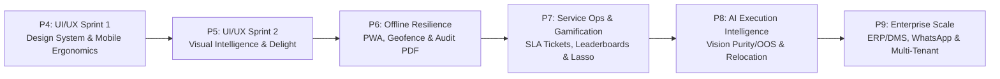

# Product Vision & Roadmap — Bassem Sales Platform

**Owner:** Product Owner (PO)  
**Baseline:** `v2.6.0` (Sprint 1 & 2 Delivered; Express API + Flutter Web + Vercel Blob)  
**Reference:** [../../docs/BRD.md](../../docs/BRD.md) | [../BOARD.md](../BOARD.md) | [COMPETITIVE_BENCHMARK.md](./COMPETITIVE_BENCHMARK.md)  
**Last Updated:** 2026-11-19

---

## 1. North Star Vision & Value Proposition

### 1.1 North Star Vision
> **Turn every commercial chiller into a high-performing revenue engine and every field visit into a guided, data-backed action—making Bassem Sales Platform the #1 FMCG Field Sales & Asset Intelligence Platform.**

FMCG distributors lose millions annually to idle or underperforming coolers, fragmented Excel workflows, blind field routing, and delayed maintenance reporting. Bassem Sales Platform eliminates that gap by uniting **geospatial asset intelligence**, **automated batch auditing**, and **mobile-first field execution** in one secure, zero-friction command center.

### 1.2 Value Proposition by Persona

| Persona | Why They Love Bassem Sales Platform | Core Outcome |
| :--- | :--- | :--- |
| **Field Sales Rep** *(e.g., Omnia)* | Opens one mobile-friendly map showing *only* their assigned stores, sequenced into an optimal daily route with offline-capable audit forms and one-tap directions. | **+25–35% more store visits/day**, zero spreadsheet clutter, faster commission attainment. |
| **Area Sales Manager** | Sees live territory coverage, rep KPI leaderboards, batch-over-batch account deltas, and immediate alerts when high-value chillers underperform. | **Real-time coaching & territory balance** without chasing WhatsApp updates or Excel sheets. |
| **Operations Director / Executive** | Tracks fleet-wide chiller ROI (Jan–Dec & YTD revenue vs. asset condition), enforces strict horizontal data isolation, and audits every historical upload. | **>40% higher asset recovery/utilization** and zero cross-territory data leakage. |
| **Audit & Asset Inspector** | Verifies serial numbers, GPS coordinates, and geo-stamped condition photos on-site, with instant admin approval/re-open feedback loops. | **100% physical-to-digital asset accuracy** and faster maintenance turnaround. |

---

## 2. Current Foundation (`P1`–`P3` Delivered: `v2.5.0` Core + `v2.6.0` Sprint 1–2)

The platform has a production-hardened core (`34/34` regression pass) plus `v2.6.0` Sprint 1 & 2 capabilities (pending `OPS-01` `public/` rebuild & `:5000` restart):

1. **Multi-Batch Spreadsheet Ingestion & DDE Protection**: Parses `.xlsx`, `.xls`, and `.csv` up to 25MB across 36+ dynamic FMCG columns while neutralizing formula injection (`=`, `+`, `-`, `@`).
2. **Immutable Historical Batch Delta Auditing**: Point-in-time snapshots comparing any two uploads for added, eliminated, or modified accounts.
3. **Interactive Geospatial Intelligence**: OpenStreetMap/Leaflet map with condition/efficiency pin coloring, live GPS `"My Location"`, and collapsible/maximizable map drawer.
4. **Universal 36+ Column Search & Compound Filtering**: Instant omni-search, per-column value-frequency chips, and smart numeric/date sorting.
5. **Strict Role-Based Territory Segregation**: Horizontal isolation (`admin` vs. `agent`) ensuring reps only see their assigned chillers and accounts.
6. **Dynamic Form Builder & Visit Review Loop**: Configurable audit forms (`text`, `choose`, `attachments`) integrated into map pins, turning pins green on submission with an admin Approve/Re-open monitor.
7. **Enterprise Security Hardening**: PBKDF2 (100,000 iterations SHA-512), timing-safe comparisons, dual rate-limiting brute-force defense, OWASP HTTP headers, and Change Password UI (`STORY-002`).
8. **Field Execution Accelerators (`v2.6.0` Sprint 1–2)**: Rep KPI Summary Strip (`ROAD-04`), Customer 360 Drawer with Jan–Dec sparkline & rule-based Next Best Action card (`ROAD-02`), and Smart Daily Route Planner with Google Maps handoff (`ROAD-03`).

---

## 3. Key Differentiators to Become #1

To leapfrog legacy SFA tools and spreadsheets, Bassem Sales Platform differentiates on **six high-impact pillars**:

1. **Field-First Ergonomics & Zero-Friction UI**: Outdoor-readable high-contrast modes, thumb-friendly mobile workflows, unified design tokens, and instant visual feedback.
2. **Smart Route & Territory Optimization**: Proximity + urgency sequencing ("Plan My Day") and visual map-lasso territory rebalancing.
3. **Offline-First Mobile / PWA Field Mode & Trust**: Local queue for zero-signal retail backrooms, 100m GPS check-in geofencing, and geo-stamped photo watermarking.
4. **Automated Service Operations & Rep Gamification**: Auto-escalated Maintenance/Scrap SLA ticketing, "Perfect Chiller" scorecards, visit streaks, and leaderboards.
5. **AI-Powered Chiller & Retail Execution Intelligence**: Computer-vision "Purity" (competitor intrusion), OOS & POSM checks, and predictive chiller relocation recommendations.
6. **Enterprise Ecosystem & Multi-Tenant Scale**: Scheduled ERP/DMS/WhatsApp sync, Executive ROI console, and multi-tenant organization isolation.

---

## 4. Post-P3 Phased Product Roadmap (`P4`–`P9`)

---

### Track A: Dedicated UI/UX Enhancement Sprints (`P4` & `P5` — PO + UI/UX)

#### Phase 4 (`P4` / `v2.6.5`) — Design System Unification, Field-First Mobile Ergonomics & Core Polish
- **Objective:** Eliminate everyday UI/UX friction across Map, Upload, and Data Table workflows, unify visual tokens, and make the app effortlessly usable one-handed in bright outdoor retail environments.
- **Key Features:**
  - **Design System Token Unification:** Standardize color palette, typography scale, spacing (`4px/8px` grid), elevation, and status badge semantics (`Performing`, `Underperforming`, `Maintenance`, `Scrap`) across all Flutter Web views.
  - **Map & Route Planner Mobile Ergonomics:** Bottom-sheet pin preview cards, larger `48x48dp` thumb-friendly controls, decluttered marker clustering at low zoom, and one-tap route stop toggling.
  - **Upload & Delta Audit Friction Removal:** Guided drag-and-drop zone with clear `.xlsx/.xls/.csv` validation feedback, step-by-step ingestion progress indicator, and cleaner Added/Eliminated/Modified delta diff pills.
  - **Data Table Mobile Cards & Sticky Controls:** Responsive card-list fallback on narrow viewports (`<768px`), sticky search/filter bar, and clear active-filter chips with 1-click "Reset All".
  - **Outdoor / High-Contrast Field Mode:** Toggleable high-contrast theme optimized for direct sunlight glare during on-site chiller inspections.
  - **Skeleton Loaders & Actionable Empty/Error States:** Replace generic spinners with layout-matched skeletons and helpful empty/error states with direct recovery CTAs.
- **Measurable Success Metrics:**
  - **<3 taps** from login to starting a daily route or submitting a chiller audit on mobile (`375px` viewport).
  - **100% component consistency** (zero ad-hoc hex colors or inconsistent badge styles across core views).
  - **>=4.5/5.0** internal field-rep usability score on mobile ergonomics and outdoor readability.
  - **40% reduction** in spreadsheet upload/validation user errors.

#### Phase 5 (`P5` / `v2.6.8`) — Executive Visual Intelligence, Interactive Workflows & Delight
- **Objective:** Elevate executive and manager decision-making through stronger KPI visual hierarchy, rich visual audit inspection, guided onboarding, and inclusive accessibility/RTL readiness.
- **Key Features:**
  - **KPI Visual Hierarchy & Drill-Downs:** Redesigned Executive & Rep KPI strip with clear primary/secondary metric hierarchy, interactive trend sparklines, and click-to-filter table/map drill-downs.
  - **Audit Photo Gallery & Lightbox Inspector:** Dedicated visual gallery in Admin Visit Review & Customer 360 supporting zoom/pan, metadata overlays, and side-by-side historical photo comparison.
  - **Guided Role-Based Onboarding:** Non-intrusive 3-step interactive walkthroughs for first-time Field Reps (Map -> Route -> Audit) and Admins (Upload -> Assign -> Review) plus contextual help tooltips.
  - **Micro-Interactions & Tactile State Feedback:** Smooth drawer transitions, pin-state animations (e.g., pin turning green on audit submit), and clear inline toast confirmations.
  - **Accessibility (WCAG AA) & Arabic RTL Readiness:** Keyboard navigation, screen-reader semantics, minimum `4.5:1` contrast ratios, and full RTL layout mirroring readiness for MENA field teams.
- **Measurable Success Metrics:**
  - **50% faster** admin audit review time per submitted visit via the Photo Gallery & side-by-side inspector.
  - **>=85% onboarding completion** for new reps without live supervisor assistance.
  - **100% WCAG AA contrast compliance** and zero layout breakage in `RTL` mirror verification.

---

### Track B: Next-Gen Features & Platform Expansion (`P6`–`P9` — PO Vision)

#### Phase 6 (`P6` / `v2.7.0`) — Offline-First Field Resilience & Trust
- **Objective:** Guarantee zero lost field data in low/no-connectivity retail backrooms and establish verifiable physical visit authenticity for management.
- **Key Features:**
  - **Offline-First PWA & Local Sync Queue (`ROAD-05`):** Service Worker + IndexedDB caching of assigned chillers, route sequence, and dynamic audit forms; offline photo & form submission queue with conflict-safe auto-sync on reconnect.
  - **100m GPS Check-In Geofencing (`ROAD-11`):** Verify rep proximity within configurable radius (default `100m`) on visit start, logging GPS accuracy and flagging out-of-range overrides for supervisor review.
  - **Geo-Stamped & Timestamped Photo Watermarking:** Automatic client-side overlay of Chiller Code, GPS coordinates, rep ID, and UTC/local timestamp onto captured audit photos to prevent photo reuse.
  - **1-Click Visual Audit PDF Export:** Branded executive PDF summary per store, batch, or territory containing chiller metadata, KPIs, and watermarked audit photos.
- **Measurable Success Metrics:**
  - **0% lost field audits** due to cellular dead zones (`100%` offline queue recovery rate).
  - **>=95% verified on-site check-ins** within 100m geofence.
  - **<5 seconds** to generate and download a multi-photo Visual Audit PDF report.

#### Phase 7 (`P7` / `v2.8.0`) — Automated Service Operations & Rep Gamification
- **Objective:** Close the loop between spotting a broken/idle chiller and resolving it under strict SLAs, while boosting daily rep engagement through transparent gamification.
- **Key Features:**
  - **Automated Maintenance & Scrap SLA Ticketing (`ROAD-06`):** Auto-create service/relocation tickets when an audit flags `Requires Maintenance` or `Scrap`, with configurable SLA timers and workflow states (`Open -> Dispatched -> In Progress -> Resolved`).
  - **"Perfect Chiller" Scorecards (`ROAD-07`):** Composite store-level score combining visit recency, chiller condition, audit approval, and YTD target achievement.
  - **Visit Streaks & Territory Leaderboards:** Daily/weekly visit streaks, audit quality badges, and branch/territory leaderboards for reps and managers.
  - **Visual Map-Lasso Bulk Reassignment:** Polygon/lasso selection directly on the map to reassign dozens of chillers between reps in seconds during territory rebalancing.
- **Measurable Success Metrics:**
  - **40% faster** mean time to resolution (MTTR) for maintenance/scrap chillers.
  - **+20% increase** in weekly active rep visit streaks and on-time territory coverage.
  - **80% reduction** in time spent by Area Managers rebalancing rep territories.

#### Phase 8 (`P8` / `v3.0.0`) — AI Chiller & Retail Execution Intelligence
- **Objective:** Transform uploaded field photos and historical sales data into automated compliance scoring and predictive revenue-uplift recommendations.
- **Key Features:**
  - **AI Chiller "Purity" Competitor Detection (`ROAD-09`):** Computer-vision analysis of audit photos to detect competitor products inside company-owned chillers and calculate shelf-purity %.
  - **OOS & POSM Compliance from Photos:** Automated detection of Out-of-Stock (OOS) shelves, missing branding/POSM stickers, and blurry/invalid photo submissions in real time.
  - **Predictive Chiller Relocation & Revenue Uplift Engine (`ROAD-08`):** ML/heuristic scoring that identifies low-ROI or "Ghost" chillers (`Condition = Good` but low/declining `YTD`) and recommends high-potential relocation outlets nearby.
- **Measurable Success Metrics:**
  - **>=85% precision/recall** on automated Purity, OOS, and POSM photo classification.
  - **>40% fleet ROI uplift** on relocated chillers within 90 days of redeployment.
  - **70% reduction** in manual admin photo-review workload via AI pre-screening.

#### Phase 9 (`P9` / `v3.2.0`) — Enterprise Ecosystem, ERP/DMS & Multi-Tenant Scale
- **Objective:** Integrate Bassem Sales Platform into the broader distributor IT ecosystem and scale the architecture for multi-organization enterprise deployment.
- **Key Features:**
  - **Scheduled ERP / DMS API & Webhook Sync (`ROAD-10`):** Automated bidirectional sync for invoices, stock, and order triggers—eliminating manual Excel uploads while preserving immutable Batch Delta snapshots.
  - **WhatsApp & Push Order/Alert Automation:** Automated WhatsApp/push notifications for urgent SLA breaches, audit re-opens, daily rep route briefings, and restock order triggers.
  - **Executive ROI & Fleet Depreciation Console:** Capital-efficiency dashboard tracking chiller payback period, maintenance cost-to-serve vs. YTD revenue, and branch asset health index.
  - **Multi-Tenant Organization Isolation (PostgreSQL + PostGIS):** Full tenant-scoped data partitioning, custom branding/roles per distributor organization, and enterprise SSO/audit logging.
- **Measurable Success Metrics:**
  - **Zero manual Excel bottlenecks** for ERP-connected distributors (`99.9%` scheduled sync reliability).
  - **<15 minute** SLA alert-to-acknowledgment via automated WhatsApp/push escalation.
  - **100% tenant data isolation** across multi-organization enterprise deployments.

---

## 5. Prioritized Enhancement Backlog (`P4`–`P9` Handoff Matrix)

| Phase | Target Release | ID | Initiative | Lead Squad | Primary Business Outcome |
| :--- | :--- | :--- | :--- | :--- | :--- |
| **P4** | `v2.6.5` | `UX-01..04` | Design System Unification, Mobile Map/Table/Upload Ergonomics, High-Contrast Mode, Skeletons | PO + UI/UX + Dev | `<3 taps` mobile workflow & 40% fewer upload/filter errors |
| **P5** | `v2.6.8` | `UX-05..08` | KPI Visual Hierarchy, Audit Photo Gallery, Guided Onboarding, Micro-interactions, WCAG AA / RTL | PO + UI/UX + Dev | 50% faster admin audit review & 85% self-serve onboarding |
| **P6** | `v2.7.0` | `ROAD-05`, `ROAD-11` | Offline-First PWA Queue, 100m GPS Check-In Geofence, Photo Watermarking, 1-Click Audit PDF | SA + Dev + QA | Zero lost field audits & 95%+ verified on-site visits |
| **P7** | `v2.8.0` | `ROAD-06`, `ROAD-07` | Automated Maintenance/Scrap SLA Ticketing, "Perfect Chiller" Scorecards, Leaderboards, Map Lasso | BA + Dev + QA | 40% faster chiller MTTR & 80% faster territory rebalancing |
| **P8** | `v3.0.0` | `ROAD-08`, `ROAD-09` | AI Chiller "Purity", OOS & POSM Vision Audit, Predictive Chiller Relocation Engine | SA + AI/ML + Dev | >40% ROI uplift on relocated chillers & 70% less manual review |
| **P9** | `v3.2.0` | `ROAD-10`, `ADR-002` | Scheduled ERP/DMS/WhatsApp Sync, Executive ROI Console, Multi-Tenant PostgreSQL/PostGIS | SA + DevOps + Dev | Zero manual Excel bottlenecks & enterprise multi-tenant scale |
