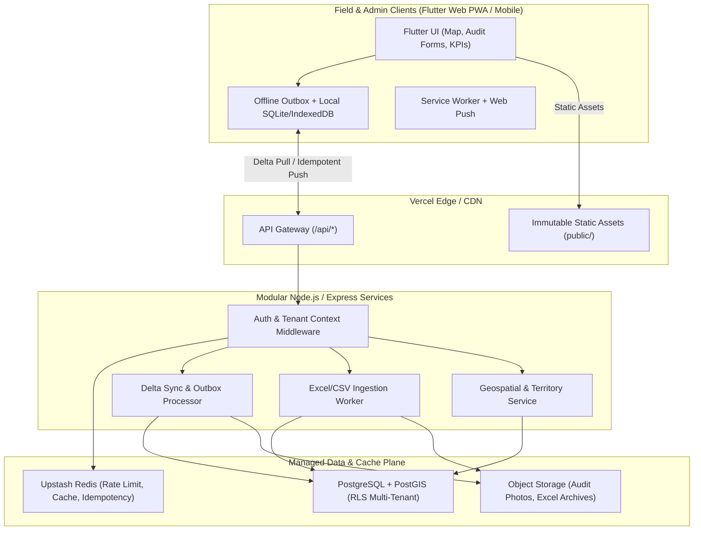

# Architecture Decisions & Technical Scalability Blueprint

**Owner:** Solution Architect / Tech Lead  
**Baseline:** `v2.5.0` (Express API + Flutter Web + Vercel Blob)  
**Last Updated:** 2026-11-19  
**References:** [docs/SAD.md](../../docs/SAD.md) · [team/BOARD.md](../BOARD.md) · [api/index.js](../../api/index.js) · [vercel.json](../../vercel.json) · [package.json](../../package.json)

---

## 1. Executive Summary & Current State Assessment (`v2.5.0`)

The Bassem Sales Platform (`v2.5.0`) has proven product-market fit for FMCG chiller intelligence and field audit operations, passing `34/34` QA remediation checks. However, its current architecture cannot scale to an **enterprise #1 field sales platform** (thousands of concurrent reps, 100k+ assets, multi-region tenants, and unreliable cellular connectivity) due to four structural bottlenecks:

| Area | Current State (`v2.5.0`) | Enterprise Bottleneck / Risk |
| :--- | :--- | :--- |
| **API Monolith** | Single [api/index.js](../../api/index.js) (`2,423` lines, `~90.8 KB`) mixing HTTP routing, auth, Excel parsing, business logic, and persistence. | High cognitive load, tight coupling, difficult unit testing, and risk of regression across 32+ endpoints. |
| **Persistence & Cold Sync** | In-memory `dbStore` backed by local JSON (`chillers_db.json`) and full-snapshot Vercel Blob sync (`syncWithCloudStorage()`). | **~894ms cold-start sync**; `saveDbStore()` writes synchronously to disk and fires `saveDatabaseToBlob()` without `await`, causing **last-write-wins data loss** across concurrent serverless invocations and `O(N)` full-dataset memory scans. |
| **Geospatial & Media** | In-memory lat/lng filtering; audit photos stored under `public/uploads` or ephemeral `/tmp/uploads` on Vercel. | Cannot perform spatial radius/polygon queries at scale; `/tmp/uploads` is lost on serverless container recycle. |
| **Frontend Build Coupling** | Flutter Web (`frontend/lib/`) compiled into static `public/` served by Express/Vercel. | Requires local Flutter SDK for every UI fix (currently blocking `DEV-05` / `DEV-06` in [team/BOARD.md](../BOARD.md)); `Cache-Control: max-age=0, must-revalidate` in [vercel.json](../../vercel.json) forces revalidation on every asset. |
| **Security & Multi-Tenancy** | Ephemeral `JWT_SECRET` fallback in prod if env var missing; open `cors()`; in-memory rate limiter; `DEFAULT_USERS` hash overwrite on load; single-tenant data model. | Serverless cold starts invalidate JWTs or reset rate-limit counters; no `tenant_id` isolation for B2B SaaS onboarding. |

---

## 2. Architecture Decision Records (ADRs)

| ADR ID | Date | Decision | Impacted Components | Status |
| :--- | :--- | :--- | :--- | :--- |
| **ADR-001** | 2026-11-19 | Decompose `api/index.js` into modular domain services & repositories | `api/`, `server.js` | Proposed |
| **ADR-002** | 2026-11-19 | Migrate JSON/Blob `dbStore` to PostgreSQL + PostGIS (Neon/Supabase) & Object Storage | Persistence, Geospatial, Uploads | Proposed |
| **ADR-003** | 2026-11-19 | Introduce Upstash Redis for distributed rate-limiting, caching & locks | Middleware, Auth, Chiller Queries | Proposed |
| **ADR-004** | 2026-11-19 | Adopt Delta-Sync + Outbox Offline-First Engine & Real-Time Push for Field Reps | Flutter Client, Sync API, Notifications | Proposed |
| **ADR-005** | 2026-11-19 | Enforce Multi-Tenant RLS, Strict JWT/CORS & Signed Upload URLs | Auth, DB Schema, Storage | Proposed |
| **ADR-006** | 2026-11-19 | Decouple Flutter Web builds via CI/CD & enable PWA asset caching | `.github/workflows/`, `vercel.json`, `public/` | Proposed |
| **ADR-007** | 2026-11-19 | Sprint 2 API Contracts: Enhanced Rep KPI, Customer 360 & NBA, Smart Daily Route Planner | `api/index.js`, Flutter Client | Accepted |

---

### ADR-001: Modular Backend Decomposition
- **Context:** `api/index.js` (`2,423` lines) contains all middleware, crypto, Excel ingestion, delta calculation, and 32+ routes in one file, making isolated testing and parallel team development slow.
- **Decision:** Refactor into a layered, domain-driven Express architecture:
  - `src/app.js` (Express app factory + global security/CORS/error middleware)
  - `src/routes/` (`auth.routes.js`, `chillers.routes.js`, `batches.routes.js`, `agents.routes.js`, `forms.routes.js`, `audit.routes.js`)
  - `src/services/` (business rules: `excelIngest.service.js`, `delta.service.js`, `assignment.service.js`)
  - `src/repositories/` (data access interfaces so JSON-to-Postgres migration happens behind stable contracts)
  - `api/index.js` becomes a thin Vercel serverless export wrapping `src/app.js`.
- **Consequences:** Enables fast Vitest/Jest unit & supertest integration suites; allows multiple developers to work concurrently without merge conflicts.

### ADR-002: PostgreSQL + PostGIS & Dedicated Object Storage
- **Context:** Full-JSON serialization to Vercel Blob (`syncWithCloudStorage`) does not scale past a few thousand records, causes ~894ms cold-start latency, and risks silent overwrites under concurrent writes.
- **Decision:**
  1. **Relational + Geospatial DB:** Migrate to **Managed PostgreSQL** (Neon Serverless Postgres or Supabase) with **PostGIS** enabled.
     - Core tables: `tenants`, `users`, `agents`, `batches`, `chillers` (with `GEOGRAPHY(Point, 4326)` + `GIST` spatial index), `chiller_history`, `assignments`, `forms`, `form_responses`, `audit_logs`.
     - Use `pg` connection pooling (`@neondatabase/serverless` or `pg-pool` with Supavisor/PgBouncer) for serverless compatibility.
  2. **Binary Media:** Use **Vercel Blob / S3-compatible storage** *exclusively* for binary assets (visit audit photos, raw Excel batch archives), never for transactional JSON state.
- **Consequences:** Eliminates cold-start full-DB downloads, supports ACID transactions for batch imports & assignments, and enables sub-20ms spatial queries (`ST_DWithin` for "Surrounding Store Radar").

### ADR-003: Distributed Redis & Edge Caching
- **Context:** Current dual-tier login rate limiting (`checkRateLimit` in `api/index.js`) uses an in-memory `Map`, which resets on every serverless cold start and does not share state across instances.
- **Decision:** Add **Upstash Redis** (HTTP-based serverless Redis):
  - **Rate Limiting & Lockouts:** Sliding-window counters per IP and user identifier.
  - **Hot Read Cache:** Cache `/api/columns`, `/api/forms/assigned`, and territory KPIs with short TTLs + event-driven invalidation on batch confirm.
  - **Idempotency Keys:** Store `Idempotency-Key` headers (`24h` TTL) for offline sync submissions to prevent duplicate visit audits.
- **Consequences:** Consistent brute-force protection across all serverless regions and reduced Postgres read load.

### ADR-004: Offline-First Sync & Real-Time Push for Field Reps
- **Context:** Field sales reps operate in low-connectivity retail/warehouse zones; `Browser LocalStorage` is size-limited (~5MB) and lacks structured conflict resolution.
- **Decision:**
  1. **Client Local Store:** Upgrade Flutter client storage from `LocalStorage` to **SQLite (`drift`) / IndexedDB** (on Web) for structured offline querying and spatial filtering.
  2. **Delta Sync Protocol:** Add `GET /api/sync/pull?since=<cursor>` returning only changed chillers, assignments, and forms (`updated_at > cursor` + `deleted_at` tombstones).
  3. **Transactional Outbox:** Queue offline visit audits (`form_responses`) and photo uploads locally with client-generated UUIDs and `Idempotency-Key` headers; flush automatically on reconnect with exponential backoff.
  4. **Real-Time Push:** Use **Server-Sent Events (SSE) / Supabase Realtime** (for active web sessions) + **FCM / Web Push** for background alerts (new territory assignment, audit review feedback).
- **Consequences:** Zero lost field audits in dead zones; 90%+ reduction in mobile payload sizes compared to full `/api/chillers` fetches.

### ADR-005: Security & Multi-Tenant Readiness
- **Context:** Enterprise B2B customers require strict tenant isolation, auditable access, and zero-trust credential handling.
- **Decision:**
  1. **Multi-Tenancy:** Add `tenant_id` to all domain tables and enforce **PostgreSQL Row-Level Security (RLS)** via session context (`SET LOCAL app.tenant_id = ...`), guaranteeing zero cross-tenant data leakage even if an application query misses a `WHERE` clause.
  2. **Auth Hardening:** Fail-fast startup if `JWT_SECRET` is missing in production (remove ephemeral `crypto.randomBytes` fallback); issue short-lived access tokens (`15m`) + rotating refresh tokens (`7d`); remove `DEFAULT_USERS` password overwrite from runtime startup.
  3. **CORS & Uploads:** Replace open `cors()` with an explicit `ALLOWED_ORIGINS` allowlist; issue pre-signed upload URLs for audit photos with MIME/magic-byte validation.
- **Consequences:** Ready for SOC 2 / enterprise security reviews and multi-organization onboarding.

### ADR-006: Decoupled Flutter Web CI/CD & PWA Caching
- **Context:** Local backend/ops work is blocked from updating UI when Flutter SDK is absent (`DEV-05`, `DEV-06`), and `vercel.json` disables browser caching for static assets.
- **Decision:**
  1. **CI Build Pipeline:** Add a GitHub Actions workflow (`.github/workflows/build-web.yml`) using `subosito/flutter-action` to run `flutter test` and `flutter build web --release`, committing or deploying `public/` artifacts automatically.
  2. **Edge Caching:** Update `vercel.json` so hashed Flutter assets (`/assets/*`, `*.js`, `*.wasm`) use `Cache-Control: public, max-age=31536000, immutable`, while `index.html` and `flutter_service_worker.js` remain `max-age=0, must-revalidate`.
- **Consequences:** Instant repeat loads for field reps on 3G/4G and zero local Flutter SDK dependency for backend/PM teams.

### ADR-007: Sprint 2 API Contracts & Business Logic (Rep KPI v2, Customer 360 & NBA, Smart Daily Route Planner)
- **Context:** Sprint 2 delivers `DEV-08` (enhanced Rep KPIs with `avgAchievement`, admin/owner `branchRollups[]`, and `branch` filter), `ROAD-02` (Customer 360 Drawer + Next Best Action Guided Selling), and `ROAD-03` (Smart Daily Route Planner) against the current `dbStore` + `raw_data_json` data model in [api/index.js](../../api/index.js), while keeping contracts compatible with `ADR-001` service extraction and `ADR-002` PostGIS migration.
- **Decision:** Implement the following three endpoints in `api/index.js` (with shared territory-scoping helper for `req.user.role === 'agent'` via `dbStore.assignments` matching `chiller_code` or case-insensitive `customer_name`):

  1. **Enhanced `GET /api/stats/rep-kpi`**
     - **Auth & Sync:** `requireAuth` (`agent`, `admin`, `owner`); preserve 30s `syncWithCloudStorage()` guard.
     - **Query Params:** `branch` (optional string; case-insensitive match on `r.branch`; ignored when omitted or `'All'`/`'all'`).
     - **Territory Scope:** Agents are restricted to their assigned chillers before any KPI aggregation or branch filtering.
     - **`avgAchievement` Calculation:** For each chiller in scope, extract a numeric percentage from `rawData` keys (`Month Ach.`, `Month Ach %`, `Achievement`, `Achievement %`, `Ach %`) or parse numeric `%` from `r.efficiency`; if no numeric % is present, map `r.efficiency` (`Performing` → `100`, `Underperforming` → `50`, `Critical` / `At Risk` → `25`). Average across scored chillers and round to 1 decimal place (`0` if empty).
     - **`branchRollups[]` (Admin/Owner Only):** When `req.user.role === 'admin' || req.user.role === 'owner'`, compute per-branch rollups across all chillers *prior* to applying `?branch=` (so the UI branch selector always lists every branch), sorted by `assignedCount` descending:
       `{ branch, assignedCount, visitedCount, pendingCount, completionRate, avgAchievement }` (empty `branch` normalized to `'Unassigned'`). Omit `branchRollups` for `agent` callers.
     - **Response (`200 OK`):**
       ```json
       {
         "success": true,
         "scope": "territory",
         "branchFilter": "All",
         "assignedCount": 42,
         "visitedCount": 28,
         "pendingCount": 14,
         "completionRate": 66.7,
         "avgAchievement": 84.2,
         "branchRollups": [
           { "branch": "Cairo", "assignedCount": 20, "visitedCount": 15, "pendingCount": 5, "completionRate": 75.0, "avgAchievement": 88.5 }
         ]
       }
       ```

  2. **Customer 360 & Next Best Action: `GET /api/chillers/:id/360`**
     - **Auth & Lookup:** `requireAuth`; sync cloud storage if stale. Match `:id` against `r.id` (string/numeric) or `r.chiller_code` (case-insensitive). Return `404` if not found.
     - **Territory Enforcement:** If `req.user.role === 'agent'` and the chiller is not in `assignedCodes` / `assignedNames`, return `403` (`Access denied: Chiller is not assigned to your territory`).
     - **Monthly Jan–Dec Invoice Summary (`invoiceSummary`):** Parse `raw_data_json` / `rawData` and extract the 12 calendar months (`Jan`..`Dec`) matching `/^(jan|feb|mar|apr|may|jun|june|jul|july|aug|sep|oct|nov|dec)\b.*invoice/i` (aligning with `DEFAULT_COLUMNS` `Jan 2026 Invoice`–`Dec 2026 Invoice`):
       - `months`: 12 items `[{ "month": "Jan", "label": "Jan 2026 Invoice", "amount": 12500 }, ...]` (default `0`).
       - `ytd`: numeric `rawData['YTD']` (fallback: sum of `months`).
       - `avgPerMonth`: numeric `rawData['Average / Month']` (fallback: `ytd / nonZeroMonthCount`).
       - `latestMonthDeltaPct`: `%` change between the last two non-zero months (`null` if `< 2` non-zero months).
     - **Visit Audit History (`visitHistory`):** All `dbStore.form_responses` matching `chiller_code` or case-insensitive `customer_name`, sorted newest-first by `submitted_at`, returning `{ id, formId, formTitle, status, agentName, adminFeedback, submittedAt, reviewedAt, answers, attachments }`.
     - **Rule-Based Next Best Action (`nextBestAction`):** Evaluate rules in strict priority order:
       1. `reopened_audit` (`priority: "high"`): Latest visit status is `'reopened'` → `"Resolve Reopened Audit"` (surface `adminFeedback`).
       2. `overdue_visit` (`priority: "high"`): `visitStatus === 'not_visited'` (or last visit > 30 days) AND `efficiency` is `'Underperforming'` / `'Critical'` → `"Priority Recovery Visit"`.
       3. `revenue_drop` (`priority: "medium"`): `latestMonthDeltaPct !== null && latestMonthDeltaPct <= -20` → `"Investigate Sales Drop & Check Stock"`.
       4. `pending_visit` (`priority: "medium"`): `visitStatus === 'not_visited'` → `"Schedule Routine Chiller Audit"`.
       5. `healthy_upsell` (`priority: "low"`): Default → `"Maintain & Cross-Sell New SKUs"`.
       - Shape: `{ actionCode, title, reason, priority, suggestedAction }`.
     - **Response (`200 OK`):** `{ success: true, chiller: { ... }, invoiceSummary, visitHistory, nextBestAction }`.

  3. **Smart Daily Route Planner: `GET /api/routes/daily`**
     - **Auth & Query Params:** `requireAuth`; optional `lat` (float), `lng` (float), `branch` (string), `visitDay` (string, matched against `rawData['Visit Day']`), `limit` (int, default `25`, max `50`).
     - **Territory & Coordinate Guard:** Restrict `agent` to assigned chillers. Exclude records lacking valid non-zero finite `latitude`/`longitude` and report `skippedNoCoordsCount`.
     - **Priority Weighting:** Score each stop: `reopened` (`+100`), `not_visited` (`+60`), `Underperforming`/`Critical` efficiency (`+40`), `submitted`/`accepted` (`+10`).
     - **Nearest-Neighbor / Priority-Weighted Ordering:**
       - Start from `(lat, lng)` if both valid query params are supplied; otherwise start at the highest-`priorityScore` stop.
       - Greedily select the next unvisited stop minimizing `weightedCost = haversineKm(current, candidate) / (1 + candidate.priorityScore / 100)` (Earth radius `6371 km`).
       - Compute `legDistanceKm`, `cumulativeKm`, `totalEstimatedKm` (rounded to 2 decimals), and `estimatedDriveMinutes` (`Math.round((totalEstimatedKm / 30) * 60)` at `30 km/h` urban average).
     - **Response (`200 OK`):**
       ```json
       {
         "success": true,
         "scope": "territory",
         "origin": { "lat": 30.0444, "lng": 31.2357 },
         "totalStops": 12,
         "skippedNoCoordsCount": 1,
         "totalEstimatedKm": 18.45,
         "estimatedDriveMinutes": 37,
         "stops": [
           {
             "order": 1,
             "id": 101,
             "chillerCode": "CH-001",
             "customerName": "Al-Noor Market",
             "customerAddress": "12 Tahrir St",
             "branch": "Cairo",
             "latitude": 30.05,
             "longitude": 31.24,
             "visitStatus": "not_visited",
             "efficiency": "Underperforming",
             "priorityScore": 100,
             "priorityReason": "Unvisited + Underperforming",
             "legDistanceKm": 1.24,
             "cumulativeKm": 1.24
           }
         ]
       }
       ```
- **Consequences:** Provides an unambiguous contract for Sprint 2 (`DEV-08`, `ROAD-02`, `ROAD-03`) in `api/index.js` and Flutter UI, and maps 1:1 to `kpi.service.js`, `customer360.service.js`, and `routing.service.js` under `ADR-001` / `ADR-002` (PostGIS `ST_Distance`).

---

## 3. Target Enterprise Architecture



---

## 4. Phased Migration Roadmap

| Phase | Target | Key Deliverables | Success Metric |
| :--- | :--- | :--- | :--- |
| **Phase 1: Stabilize & Decouple** | `v2.6.0` | Modularize `api/index.js` behind repository interfaces; enforce `JWT_SECRET` & CORS allowlist; add GitHub Actions Flutter Web build + immutable asset caching; add Vitest API test suite. | Zero-downtime refactor; CI builds `public/` automatically; `100%` endpoint parity. |
| **Phase 2: Postgres + PostGIS** | `v2.7.0` | Provision Neon/Supabase Postgres + PostGIS; run one-time migration script from `chillers_db.json`; move audit photos to Vercel Blob/S3; remove `syncWithCloudStorage()` & `dbStore`. | Cold-start latency `< 100ms` (down from `~894ms`); zero concurrent write data loss. |
| **Phase 3: Offline-First & Redis** | `v2.8.0` | Add Upstash Redis rate-limiting & idempotency; implement `/api/sync/pull` cursor sync + client outbox queue; enable SSE/WebPush for assignment alerts. | Full offline audit capability; `90%` smaller sync payloads. |
| **Phase 4: Enterprise Multi-Tenant** | `v3.0.0` | Enable `tenant_id` + Postgres RLS across all tables; tenant onboarding & RBAC; dedicated background worker for 100k+ row Excel imports. | Support `100+` enterprise tenants & `10k+` concurrent field reps. |
