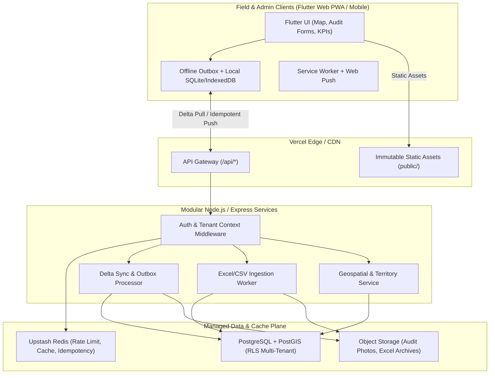

# Architecture Decisions & Technical Scalability Blueprint

**Owner:** Solution Architect / Tech Lead  
**Baseline:** `v2.5.0` (Express API + Flutter Web + Vercel Blob)  
**Last Updated:** 2026-11-19  
**References:** [docs/SAD.md](../../docs/SAD.md) · [team/BOARD.md](../BOARD.md) · [api/index.js](../../api/index.js) · [vercel.json](../../vercel.json) · [package.json](../../package.json)

---

## 1. Executive Summary & Current State Assessment (`v2.5.0`)

The Bassem Sales Platform (`v2.5.0`) has proven product-market fit for FMCG chiller intelligence and field audit operations, passing `34/34` QA remediation checks. However, its current architecture cannot scale to an **enterprise #1 field sales platform** (thousands of concurrent reps, 100k+ assets, multi-region tenants, and unreliable cellular connectivity) due to four structural bottlenecks:

| Area | Current State (`v2.5.0`) | Enterprise Bottleneck / Risk |
| :--- | :--- | :--- |
| **API Monolith** | Single [api/index.js](../../api/index.js) (`2,423` lines, `~90.8 KB`) mixing HTTP routing, auth, Excel parsing, business logic, and persistence. | High cognitive load, tight coupling, difficult unit testing, and risk of regression across 32+ endpoints. |
| **Persistence & Cold Sync** | In-memory `dbStore` backed by local JSON (`chillers_db.json`) and full-snapshot Vercel Blob sync (`syncWithCloudStorage()`). | **~894ms cold-start sync**; `saveDbStore()` writes synchronously to disk and fires `saveDatabaseToBlob()` without `await`, causing **last-write-wins data loss** across concurrent serverless invocations and `O(N)` full-dataset memory scans. |
| **Geospatial & Media** | In-memory lat/lng filtering; audit photos stored under `public/uploads` or ephemeral `/tmp/uploads` on Vercel. | Cannot perform spatial radius/polygon queries at scale; `/tmp/uploads` is lost on serverless container recycle. |
| **Frontend Build Coupling** | Flutter Web (`frontend/lib/`) compiled into static `public/` served by Express/Vercel. | Requires local Flutter SDK for every UI fix (currently blocking `DEV-05` / `DEV-06` in [team/BOARD.md](../BOARD.md)); `Cache-Control: max-age=0, must-revalidate` in [vercel.json](../../vercel.json) forces revalidation on every asset. |
| **Security & Multi-Tenancy** | Ephemeral `JWT_SECRET` fallback in prod if env var missing; open `cors()`; in-memory rate limiter; `DEFAULT_USERS` hash overwrite on load; single-tenant data model. | Serverless cold starts invalidate JWTs or reset rate-limit counters; no `tenant_id` isolation for B2B SaaS onboarding. |

---

## 2. Architecture Decision Records (ADRs)

| ADR ID | Date | Decision | Impacted Components | Status |
| :--- | :--- | :--- | :--- | :--- |
| **ADR-001** | 2026-11-19 | Decompose `api/index.js` into modular domain services & repositories | `api/`, `server.js` | Proposed |
| **ADR-002** | 2026-11-19 | Migrate JSON/Blob `dbStore` to PostgreSQL + PostGIS (Neon/Supabase) & Object Storage | Persistence, Geospatial, Uploads | Proposed |
| **ADR-003** | 2026-11-19 | Introduce Upstash Redis for distributed rate-limiting, caching & locks | Middleware, Auth, Chiller Queries | Proposed |
| **ADR-004** | 2026-11-19 | Adopt Delta-Sync + Outbox Offline-First Engine & Real-Time Push for Field Reps | Flutter Client, Sync API, Notifications | Proposed |
| **ADR-005** | 2026-11-19 | Enforce Multi-Tenant RLS, Strict JWT/CORS & Signed Upload URLs | Auth, DB Schema, Storage | Proposed |
| **ADR-006** | 2026-11-19 | Decouple Flutter Web builds via CI/CD & enable PWA asset caching | `.github/workflows/`, `vercel.json`, `public/` | Proposed |
| **ADR-007** | 2026-11-19 | Sprint 2 API Contracts: Enhanced Rep KPI, Customer 360 & NBA, Smart Daily Route Planner | `api/index.js`, Flutter Client | Accepted |
| **ADR-008** | 2026-11-19 | Hierarchical Sales RBAC, Dashboard Analytics & Technician Condition Updates | `api/middleware/auth.js`, `api/services/storage.js`, `api/services/chillerHelpers.js`, `api/routes/*` | Accepted |
| **ADR-009** | 2026-11-19 | P6 (`v2.7.0`): Offline-First Delta Sync, 100m GPS Geofencing, Geo-Stamped Photos & Audit Export | `api/routes/sync.js`, `api/routes/forms.js`, `api/routes/chillers.js`, `api/services/storage.js`, Flutter Client | Accepted |

---

### ADR-001: Modular Backend Decomposition
- **Context:** `api/index.js` (`2,423` lines) contains all middleware, crypto, Excel ingestion, delta calculation, and 32+ routes in one file, making isolated testing and parallel team development slow.
- **Decision:** Refactor into a layered, domain-driven Express architecture:
  - `src/app.js` (Express app factory + global security/CORS/error middleware)
  - `src/routes/` (`auth.routes.js`, `chillers.routes.js`, `batches.routes.js`, `agents.routes.js`, `forms.routes.js`, `audit.routes.js`)
  - `src/services/` (business rules: `excelIngest.service.js`, `delta.service.js`, `assignment.service.js`)
  - `src/repositories/` (data access interfaces so JSON-to-Postgres migration happens behind stable contracts)
  - `api/index.js` becomes a thin Vercel serverless export wrapping `src/app.js`.
- **Consequences:** Enables fast Vitest/Jest unit & supertest integration suites; allows multiple developers to work concurrently without merge conflicts.

### ADR-002: PostgreSQL + PostGIS & Dedicated Object Storage
- **Context:** Full-JSON serialization to Vercel Blob (`syncWithCloudStorage`) does not scale past a few thousand records, causes ~894ms cold-start latency, and risks silent overwrites under concurrent writes.
- **Decision:**
  1. **Relational + Geospatial DB:** Migrate to **Managed PostgreSQL** (Neon Serverless Postgres or Supabase) with **PostGIS** enabled.
     - Core tables: `tenants`, `users`, `agents`, `batches`, `chillers` (with `GEOGRAPHY(Point, 4326)` + `GIST` spatial index), `chiller_history`, `assignments`, `forms`, `form_responses`, `audit_logs`.
     - Use `pg` connection pooling (`@neondatabase/serverless` or `pg-pool` with Supavisor/PgBouncer) for serverless compatibility.
  2. **Binary Media:** Use **Vercel Blob / S3-compatible storage** *exclusively* for binary assets (visit audit photos, raw Excel batch archives), never for transactional JSON state.
- **Consequences:** Eliminates cold-start full-DB downloads, supports ACID transactions for batch imports & assignments, and enables sub-20ms spatial queries (`ST_DWithin` for "Surrounding Store Radar").

### ADR-003: Distributed Redis & Edge Caching
- **Context:** Current dual-tier login rate limiting (`checkRateLimit` in `api/index.js`) uses an in-memory `Map`, which resets on every serverless cold start and does not share state across instances.
- **Decision:** Add **Upstash Redis** (HTTP-based serverless Redis):
  - **Rate Limiting & Lockouts:** Sliding-window counters per IP and user identifier.
  - **Hot Read Cache:** Cache `/api/columns`, `/api/forms/assigned`, and territory KPIs with short TTLs + event-driven invalidation on batch confirm.
  - **Idempotency Keys:** Store `Idempotency-Key` headers (`24h` TTL) for offline sync submissions to prevent duplicate visit audits.
- **Consequences:** Consistent brute-force protection across all serverless regions and reduced Postgres read load.

### ADR-004: Offline-First Sync & Real-Time Push for Field Reps
- **Context:** Field sales reps operate in low-connectivity retail/warehouse zones; `Browser LocalStorage` is size-limited (~5MB) and lacks structured conflict resolution.
- **Decision:**
  1. **Client Local Store:** Upgrade Flutter client storage from `LocalStorage` to **SQLite (`drift`) / IndexedDB** (on Web) for structured offline querying and spatial filtering.
  2. **Delta Sync Protocol:** Add `GET /api/sync/pull?since=<cursor>` returning only changed chillers, assignments, and forms (`updated_at > cursor` + `deleted_at` tombstones).
  3. **Transactional Outbox:** Queue offline visit audits (`form_responses`) and photo uploads locally with client-generated UUIDs and `Idempotency-Key` headers; flush automatically on reconnect with exponential backoff.
  4. **Real-Time Push:** Use **Server-Sent Events (SSE) / Supabase Realtime** (for active web sessions) + **FCM / Web Push** for background alerts (new territory assignment, audit review feedback).
- **Consequences:** Zero lost field audits in dead zones; 90%+ reduction in mobile payload sizes compared to full `/api/chillers` fetches.

### ADR-005: Security & Multi-Tenant Readiness
- **Context:** Enterprise B2B customers require strict tenant isolation, auditable access, and zero-trust credential handling.
- **Decision:**
  1. **Multi-Tenancy:** Add `tenant_id` to all domain tables and enforce **PostgreSQL Row-Level Security (RLS)** via session context (`SET LOCAL app.tenant_id = ...`), guaranteeing zero cross-tenant data leakage even if an application query misses a `WHERE` clause.
  2. **Auth Hardening:** Fail-fast startup if `JWT_SECRET` is missing in production (remove ephemeral `crypto.randomBytes` fallback); issue short-lived access tokens (`15m`) + rotating refresh tokens (`7d`); remove `DEFAULT_USERS` password overwrite from runtime startup.
  3. **CORS & Uploads:** Replace open `cors()` with an explicit `ALLOWED_ORIGINS` allowlist; issue pre-signed upload URLs for audit photos with MIME/magic-byte validation.
- **Consequences:** Ready for SOC 2 / enterprise security reviews and multi-organization onboarding.

### ADR-006: Decoupled Flutter Web CI/CD & PWA Caching
- **Context:** Local backend/ops work is blocked from updating UI when Flutter SDK is absent (`DEV-05`, `DEV-06`), and `vercel.json` disables browser caching for static assets.
- **Decision:**
  1. **CI Build Pipeline:** Add a GitHub Actions workflow (`.github/workflows/build-web.yml`) using `subosito/flutter-action` to run `flutter test` and `flutter build web --release`, committing or deploying `public/` artifacts automatically.
  2. **Edge Caching:** Update `vercel.json` so hashed Flutter assets (`/assets/*`, `*.js`, `*.wasm`) use `Cache-Control: public, max-age=31536000, immutable`, while `index.html` and `flutter_service_worker.js` remain `max-age=0, must-revalidate`.
- **Consequences:** Instant repeat loads for field reps on 3G/4G and zero local Flutter SDK dependency for backend/PM teams.

### ADR-007: Sprint 2 API Contracts & Business Logic (Rep KPI v2, Customer 360 & NBA, Smart Daily Route Planner)
- **Context:** Sprint 2 delivers `DEV-08` (enhanced Rep KPIs with `avgAchievement`, admin/owner `branchRollups[]`, and `branch` filter), `ROAD-02` (Customer 360 Drawer + Next Best Action Guided Selling), and `ROAD-03` (Smart Daily Route Planner) against the current `dbStore` + `raw_data_json` data model in [api/index.js](../../api/index.js), while keeping contracts compatible with `ADR-001` service extraction and `ADR-002` PostGIS migration.
- **Decision:** Implement the following three endpoints in `api/index.js` (with shared territory-scoping helper for `req.user.role === 'agent'` via `dbStore.assignments` matching `chiller_code` or case-insensitive `customer_name`):

  1. **Enhanced `GET /api/stats/rep-kpi`**
     - **Auth & Sync:** `requireAuth` (`agent`, `admin`, `owner`); preserve 30s `syncWithCloudStorage()` guard.
     - **Query Params:** `branch` (optional string; case-insensitive match on `r.branch`; ignored when omitted or `'All'`/`'all'`).
     - **Territory Scope:** Agents are restricted to their assigned chillers before any KPI aggregation or branch filtering.
     - **`avgAchievement` Calculation:** For each chiller in scope, extract a numeric percentage from `rawData` keys (`Month Ach.`, `Month Ach %`, `Achievement`, `Achievement %`, `Ach %`) or parse numeric `%` from `r.efficiency`; if no numeric % is present, map `r.efficiency` (`Performing` → `100`, `Underperforming` → `50`, `Critical` / `At Risk` → `25`). Average across scored chillers and round to 1 decimal place (`0` if empty).
     - **`branchRollups[]` (Admin/Owner Only):** When `req.user.role === 'admin' || req.user.role === 'owner'`, compute per-branch rollups across all chillers *prior* to applying `?branch=` (so the UI branch selector always lists every branch), sorted by `assignedCount` descending:
       `{ branch, assignedCount, visitedCount, pendingCount, completionRate, avgAchievement }` (empty `branch` normalized to `'Unassigned'`). Omit `branchRollups` for `agent` callers.
     - **Response (`200 OK`):**
       ```json
       {
         "success": true,
         "scope": "territory",
         "branchFilter": "All",
         "assignedCount": 42,
         "visitedCount": 28,
         "pendingCount": 14,
         "completionRate": 66.7,
         "avgAchievement": 84.2,
         "branchRollups": [
           { "branch": "Cairo", "assignedCount": 20, "visitedCount": 15, "pendingCount": 5, "completionRate": 75.0, "avgAchievement": 88.5 }
         ]
       }
       ```

  2. **Customer 360 & Next Best Action: `GET /api/chillers/:id/360`**
     - **Auth & Lookup:** `requireAuth`; sync cloud storage if stale. Match `:id` against `r.id` (string/numeric) or `r.chiller_code` (case-insensitive). Return `404` if not found.
     - **Territory Enforcement:** If `req.user.role === 'agent'` and the chiller is not in `assignedCodes` / `assignedNames`, return `403` (`Access denied: Chiller is not assigned to your territory`).
     - **Monthly Jan–Dec Invoice Summary (`invoiceSummary`):** Parse `raw_data_json` / `rawData` and extract the 12 calendar months (`Jan`..`Dec`) matching `/^(jan|feb|mar|apr|may|jun|june|jul|july|aug|sep|oct|nov|dec)\b.*invoice/i` (aligning with `DEFAULT_COLUMNS` `Jan 2026 Invoice`–`Dec 2026 Invoice`):
       - `months`: 12 items `[{ "month": "Jan", "label": "Jan 2026 Invoice", "amount": 12500 }, ...]` (default `0`).
       - `ytd`: numeric `rawData['YTD']` (fallback: sum of `months`).
       - `avgPerMonth`: numeric `rawData['Average / Month']` (fallback: `ytd / nonZeroMonthCount`).
       - `latestMonthDeltaPct`: `%` change between the last two non-zero months (`null` if `< 2` non-zero months).
     - **Visit Audit History (`visitHistory`):** All `dbStore.form_responses` matching `chiller_code` or case-insensitive `customer_name`, sorted newest-first by `submitted_at`, returning `{ id, formId, formTitle, status, agentName, adminFeedback, submittedAt, reviewedAt, answers, attachments }`.
     - **Rule-Based Next Best Action (`nextBestAction`):** Evaluate rules in strict priority order:
       1. `reopened_audit` (`priority: "high"`): Latest visit status is `'reopened'` → `"Resolve Reopened Audit"` (surface `adminFeedback`).
       2. `overdue_visit` (`priority: "high"`): `visitStatus === 'not_visited'` (or last visit > 30 days) AND `efficiency` is `'Underperforming'` / `'Critical'` → `"Priority Recovery Visit"`.
       3. `revenue_drop` (`priority: "medium"`): `latestMonthDeltaPct !== null && latestMonthDeltaPct <= -20` → `"Investigate Sales Drop & Check Stock"`.
       4. `pending_visit` (`priority: "medium"`): `visitStatus === 'not_visited'` → `"Schedule Routine Chiller Audit"`.
       5. `healthy_upsell` (`priority: "low"`): Default → `"Maintain & Cross-Sell New SKUs"`.
       - Shape: `{ actionCode, title, reason, priority, suggestedAction }`.
     - **Response (`200 OK`):** `{ success: true, chiller: { ... }, invoiceSummary, visitHistory, nextBestAction }`.

  3. **Smart Daily Route Planner: `GET /api/routes/daily`**
     - **Auth & Query Params:** `requireAuth`; optional `lat` (float), `lng` (float), `branch` (string), `visitDay` (string, matched against `rawData['Visit Day']`), `limit` (int, default `25`, max `50`).
     - **Territory & Coordinate Guard:** Restrict `agent` to assigned chillers. Exclude records lacking valid non-zero finite `latitude`/`longitude` and report `skippedNoCoordsCount`.
     - **Priority Weighting:** Score each stop: `reopened` (`+100`), `not_visited` (`+60`), `Underperforming`/`Critical` efficiency (`+40`), `submitted`/`accepted` (`+10`).
     - **Nearest-Neighbor / Priority-Weighted Ordering:**
       - Start from `(lat, lng)` if both valid query params are supplied; otherwise start at the highest-`priorityScore` stop.
       - Greedily select the next unvisited stop minimizing `weightedCost = haversineKm(current, candidate) / (1 + candidate.priorityScore / 100)` (Earth radius `6371 km`).
       - Compute `legDistanceKm`, `cumulativeKm`, `totalEstimatedKm` (rounded to 2 decimals), and `estimatedDriveMinutes` (`Math.round((totalEstimatedKm / 30) * 60)` at `30 km/h` urban average).
     - **Response (`200 OK`):**
       ```json
       {
         "success": true,
         "scope": "territory",
         "origin": { "lat": 30.0444, "lng": 31.2357 },
         "totalStops": 12,
         "skippedNoCoordsCount": 1,
         "totalEstimatedKm": 18.45,
         "estimatedDriveMinutes": 37,
         "stops": [
           {
             "order": 1,
             "id": 101,
             "chillerCode": "CH-001",
             "customerName": "Al-Noor Market",
             "customerAddress": "12 Tahrir St",
             "branch": "Cairo",
             "latitude": 30.05,
             "longitude": 31.24,
             "visitStatus": "not_visited",
             "efficiency": "Underperforming",
             "priorityScore": 100,
             "priorityReason": "Unvisited + Underperforming",
             "legDistanceKm": 1.24,
             "cumulativeKm": 1.24
           }
         ]
       }
       ```
- **Consequences:** Provides an unambiguous contract for Sprint 2 (`DEV-08`, `ROAD-02`, `ROAD-03`) in `api/index.js` and Flutter UI, and maps 1:1 to `kpi.service.js`, `customer360.service.js`, and `routing.service.js` under `ADR-001` / `ADR-002` (PostGIS `ST_Distance`).

### ADR-008: Hierarchical Sales RBAC, Role-Tailored Dashboard Analytics & Technician Condition Updates
- **Context:** Following `ADR-001` modularization (`api/middleware/auth.js`, `api/services/storage.js`, `api/services/chillerHelpers.js`, `api/routes/*`), the platform only models `owner`, `admin`, and `agent`. Enterprise field operations require a 5-tier sales & maintenance hierarchy (`owner`, `regional_manager`, `supervisor`, `agent`, `technician`), a unified role-scoped dashboard analytics endpoint (`GET /api/stats/dashboard`), and a dedicated asset condition update workflow (`PATCH /api/chillers/:id/condition`) without breaking any existing `owner@sales.com`, `admin@sales.com`, `omnia@sales.com`, or `mina@sales.com` auth/RBAC tests.
- **Decision:**

  1. **Backward-Compatible Hierarchical RBAC (`api/middleware/auth.js`, `api/services/storage.js`, `api/services/chillerHelpers.js`, `api/routes/*`)**
     - **Supported Roles & Hierarchy:**
       - `owner`: Global system owner (all chillers, all branches, user/admin management, audit logs).
       - `regional_manager`: Alias/peer to `admin` with full cross-branch operational & administrative privileges (cannot access Owner-only `/api/logs*` endpoints).
       - `supervisor`: Branch/team lead scoped to assigned `branch` and/or `supervisedAgentIds`. Can view scoped chillers, manage/review scoped form responses, and update chiller conditions within their scope.
       - `agent`: Field sales rep strictly scoped to their assigned chillers (`agentId` via `dbStore.assignments`).
       - `technician`: Field maintenance role with read access to chillers (scoped to `branch` if set, otherwise all assets) and write access to `PATCH /api/chillers/:id/condition`. Denied access to admin batch imports, user/agent management, and form reviews.
     - **Middleware Extensions (`api/middleware/auth.js`):**
       - Preserve `attachUser`, `requireAuth`, `requireAdmin`, and `requireOwner` exports and signatures.
       - Add `ADMIN_ROLES = new Set(['owner', 'admin', 'regional_manager'])` and `isAdminRole(user)` helper. Update `requireAdmin` to allow `owner`, `admin`, and `regional_manager`.
       - Add `requireRoles(...allowedRoles)` middleware factory returning `401` if unauthenticated and `403` if `!allowedRoles.includes(req.user.role)`.
     - **JWT & User Profile (`api/routes/auth.js`):**
       - Include optional `branch: user.branch || null` and `supervisedAgentIds: Array.isArray(user.supervised_agent_ids) ? user.supervised_agent_ids : []` in JWT claims and `/api/auth/login` + `/api/auth/me` responses, keeping all existing fields (`id`, `email`, `username`, `name`, `role`, `agentId`, `agentArea`) unchanged.
     - **Unified Territory & Branch Scoping (`api/services/chillerHelpers.js`):**
       - Extend `filterRowsByTerritory(rows, user, store)` and add `canUserAccessChiller(row, user, store)`:
         - `owner`, `admin`, `regional_manager`: full access (all rows).
         - `supervisor`: match if `(row.branch || '').trim().toLowerCase() === (user.branch || '').trim().toLowerCase()` (when `user.branch` is set) **OR** chiller is assigned to any `agentId` in `user.supervisedAgentIds`. Fail-closed (`[]`) if neither is configured.
         - `agent`: existing `getAgentAssignedSets(user.agentId, store)` logic.
         - `technician`: if `user.branch` is set, filter to matching `branch`; otherwise return all rows for field maintenance visibility.
       - Update `api/routes/chillers.js`, `api/routes/agents.js`, and `api/routes/forms.js` to use `isAdminRole(req.user)` / `filterRowsByTerritory()` / `requireRoles(...)` instead of raw `req.user.role === 'agent'` or `requireAdmin` where `supervisor` / `regional_manager` / `technician` access is intended.
     - **Seeded Demo/Test Accounts (`DEFAULT_USERS` in `api/services/storage.js`):**
       - Preserve `owner@sales.com` (`id: 0`), `admin@sales.com` (`id: 1`), `omnia@sales.com` (`id: 2`, `agent_id: 1`), and `mina@sales.com` (`id: 3`, `agent_id: 2`) with their exact IDs, salts, and PBKDF2-SHA512 hashes.
       - Add two new `DEFAULT_USERS` entries with precomputed PBKDF2-SHA512 (100k iterations) `salt` and `password_hash`:
         - `supervisor@sales.com` (`id: 4`, `username: 'supervisor'`, `name: 'Branch Supervisor'`, `role: 'supervisor'`, `agent_id: null`, `branch: 'Cairo'`, `supervised_agent_ids: [1, 2]`).
         - `tech@sales.com` (`id: 5`, `username: 'tech'`, `name: 'Field Technician'`, `role: 'technician'`, `agent_id: null`, `branch: null`, `supervised_agent_ids: []`).
       - `syncWithCloudStorage()` merges `DEFAULT_USERS` by email, ensuring existing cloud snapshots automatically receive `supervisor@sales.com` and `tech@sales.com` without mutating existing test accounts.

  2. **Role-Tailored Dashboard Analytics (`GET /api/stats/dashboard`)**
     - **Auth & Sync:** `requireAuth` (all roles) + `await ensureFreshCloudSync()`.
     - **Query Params:** Optional `branch` (case-insensitive; ignored when omitted or `'All'`/`'all'`) and `batchId` (optional; defaults to current `dbStore.chillers`, or historical/filtered batch when specified).
     - **Scoping:** Apply `filterRowsByTerritory(rows, req.user, dbStore)` first, then apply `?branch=` filter (intersecting with supervisor/agent scope).
     - **KPI & Breakdown Rules:**
       - Normalize `condition`: `'Requires Maintenance'` (case-insensitive / includes `'maint'`), `'Scrap'` (case-insensitive `'scrap'`), `'Operational'` (explicit `'operational'` or default when non-empty/active; track unset separately in `conditionBreakdown.unknown` while counting active non-maintenance/non-scrap assets in `activeOperational` or explicit `'Operational'` — specifically: `requiresMaintenance` = condition matches `maint`, `scrapCount` = condition matches `scrap`, `activeOperational` = `totalAssets - requiresMaintenance - scrapCount`).
       - `ytdInvoiceTotal`: sum of numeric `rawData['YTD']` (fallback: sum of `Jan`..`Dec` invoice columns) across scoped rows, rounded to 2 decimals.
       - `efficiencyBuckets`: `{ performing, underperforming, critical, other }` derived from normalized `r.efficiency`.
       - `branchLeaderboard[]`: per-branch rollup `{ branch, totalAssets, visitedCount, pendingCount, completionRate, avgAchievement, ytdInvoiceTotal, requiresMaintenance }`, sorted by `avgAchievement` desc then `totalAssets` desc.
       - `agentLeaderboard[]`: per-agent rollup `{ agentId, agentName, area, assignedCount, visitedCount, pendingCount, completionRate, avgAchievement }`, sorted by `completionRate` desc then `visitedCount` desc (`owner`/`admin`/`regional_manager`: all agents; `supervisor`: `supervisedAgentIds` or agents with chillers in `user.branch`; `agent`: self only; `technician`: `[]`).
       - `pendingReviewsCount`: count of `dbStore.form_responses` with `status === 'submitted'` within the caller's scoped chillers (`0` for `agent` and `technician`).
       - `maintenanceQueue[]`: scoped chillers where normalized condition is `'Requires Maintenance'` or `'Scrap'`, mapped to `{ id, chillerCode, customerName, customerAddress, branch, condition, efficiency, latitude, longitude, lastUpdated }` (`Requires Maintenance` sorted first).
     - **Response (`200 OK`):**
       ```json
       {
         "success": true,
         "role": "supervisor",
         "scope": "branch",
         "branchFilter": "All",
         "kpis": {
           "totalAssets": 42,
           "activeOperational": 35,
           "requiresMaintenance": 5,
           "scrapCount": 2,
           "visitedCount": 28,
           "pendingCount": 14,
           "completionRate": 66.7,
           "avgAchievement": 84.2,
           "ytdInvoiceTotal": 1245000.5
         },
         "conditionBreakdown": { "operational": 35, "requiresMaintenance": 5, "scrap": 2 },
         "efficiencyBuckets": { "performing": 24, "underperforming": 12, "critical": 6, "other": 0 },
         "branchLeaderboard": [],
         "agentLeaderboard": [],
         "pendingReviewsCount": 4,
         "maintenanceQueue": []
       }
       ```

  3. **Technician / Supervisor Condition Update (`PATCH /api/chillers/:id/condition`)**
     - **Auth & Scope:** `requireAuth` + `requireRoles('owner', 'admin', 'regional_manager', 'supervisor', 'technician')` (returns `403` for `agent`). Run `await ensureFreshCloudSync()` before lookup.
     - **Lookup & Territory Guard:** Match `:id` against `String(r.id)` or case-insensitive `r.chiller_code` / `r.chillerCode` (`404` if missing). If `req.user.role === 'supervisor'` and `!canUserAccessChiller(chiller, req.user, dbStore)`, return `403`.
     - **Validation:** `req.body.condition` must strictly match one of `'Operational'`, `'Requires Maintenance'`, or `'Scrap'` (`400` otherwise). Optional `req.body.notes` (string, trimmed, max 500 chars).
     - **Mutation, Audit & Persistence:**
       - Record `previousCondition = chiller.condition || 'Operational'`.
       - Update `chiller.condition = condition`, `chiller.condition_updated_at = new Date().toISOString()`, `chiller.condition_updated_by = req.user.email || req.user.username`, and sync `Condiiton` / `Condition` inside `raw_data_json` if present.
       - Populate `req.auditEvent` (`category: 'chiller'`, `action: 'CHILLER_CONDITION_UPDATED'`, `details`, `metadata: { chillerId: chiller.id, chillerCode, previousCondition, newCondition: condition, notes }`).
       - Persist via `saveDbStore(dbStore)` **and** `await persistToBlobIfConfigured(dbStore)` before returning `200 OK` with `{ success: true, message: 'Chiller condition updated', chiller: formatChillerRecord(chiller, dbStore) }`.
- **Consequences:** Enables hierarchical enterprise sales & maintenance workflows with zero breaking changes to existing `owner`, `admin`, and `agent` contracts, and maps cleanly to PostgreSQL RLS role claims (`app.role`, `app.branch`, `app.tenant_id`) in Phase 4 (`ADR-005`).

### ADR-009: P6 (`v2.7.0`) — Offline-First Field Resilience & Trust
- **Context:** Field sales reps and technicians operate in low-connectivity retail/warehouse zones where full `/api/chillers` fetches waste bandwidth and dropped requests risk lost visit audits. Additionally, enterprise audit trust requires verifying physical presence at the store (100m GPS geofence), tamper-evident geo-stamped photo evidence, and a 1-click printable/PDF audit report for supervisors and customers. This ADR concretizes `ADR-004` on top of the modular `v2.6.x` Express architecture (`api/routes/*`, `api/services/storage.js`, `api/services/chillerHelpers.js`) while remaining 100% forward-compatible with PostgreSQL + PostGIS (`ADR-002`) and Upstash Redis (`ADR-003`).
- **Decision:**

  1. **Offline-First Delta Sync & Outbox (`api/routes/sync.js`, mounted under `/api`)**
     - **Storage Extensions (`api/services/storage.js`):**
       - Ensure `dbStore.idempotency_keys` (array of `{ key, userId, createdAt, statusCode, result }`, pruned past `24h` TTL) and `dbStore.tombstones` (`{ chillers: [], forms: [], assignments: [] }` storing `{ id, deletedAt }`) are initialized on load/sync.
       - Ensure mutating routes stamp `updated_at` (ISO-8601) on `chillers`, `forms`, and `assignments` so cursor-based delta queries are deterministic.
     - **Delta Pull: `GET /api/sync/pull?since=<iso>`**
       - **Auth & Sync:** `requireAuth` (all roles) + `await ensureFreshCloudSync()`.
       - **Query Params:** `since` (optional ISO-8601 timestamp). If omitted/empty, performs a full bootstrap sync (`isFullSync: true`). If provided and invalid (`Number.isNaN(Date.parse(since))`), return `400 Bad Request`.
       - **Cursor & Consistency:** Capture `serverTime = new Date().toISOString()` *before* filtering records so clients use `serverTime` as their next `since` cursor without missing concurrent writes.
       - **Territory Scoping & Filtering:**
         - `chillers`: Apply `filterRowsByTerritory(dbStore.chillers || [], req.user, dbStore)`, filter where `(r.updated_at || r.condition_updated_at || r.created_at)` is `> since` (or include all when `isFullSync` or record lacks timestamps), and map via `formatChillerRecord(r, dbStore)`.
         - `forms`: If `req.user.role === 'agent'`, include forms where `assigned_agent_ids` is empty or contains `req.user.agentId`; otherwise all forms. Filter by `(f.updated_at || f.created_at) > since`.
         - `assignments`: Scope by role (`agent`: `as.agent_id === req.user.agentId`; `supervisor`: `supervisedAgentIds` or matching chiller in `user.branch`; `owner`/`admin`/`regional_manager`: all; `technician`: `[]`). Filter by `(as.updated_at || as.assigned_at || as.created_at) > since`.
         - `tombstones`: Return `{ chillerCodes, formIds, assignmentIds }` deleted after `since` (empty arrays on full sync).
       - **Response (`200 OK`):**
         ```json
         {
           "success": true,
           "serverTime": "2026-11-19T15:20:50.000Z",
           "since": "2026-11-18T10:00:00.000Z",
           "isFullSync": false,
           "counts": { "chillers": 3, "forms": 1, "assignments": 2 },
           "chillers": [],
           "forms": [],
           "assignments": [],
           "tombstones": { "chillerCodes": [], "formIds": [], "assignmentIds": [] }
         }
         ```
     - **Transactional Outbox Flush: `POST /api/sync/batch`**
       - **Auth & Sync:** `requireAuth` + `requireRoles('owner', 'admin', 'regional_manager', 'supervisor', 'agent', 'technician')` + `await ensureFreshCloudSync()`.
       - **Idempotency (`Idempotency-Key`):**
         - Support optional request header `Idempotency-Key` for batch-level deduplication (`userId + ':' + headerKey`) **and** per-operation `idempotencyKey` (required string per item, max 128 chars) for item-level deduplication.
         - If the batch-level `Idempotency-Key` already exists in `dbStore.idempotency_keys` (within `24h` TTL) for the same `req.user.id`, return `200 OK` with `{ success: true, deduplicated: true, ...cachedResult }`.
         - If an individual item's `idempotencyKey` was already processed, skip re-execution and return `{ index, type, idempotencyKey, status: 'duplicate', statusCode: 200, resourceId }` in `results[]`.
       - **Request Body:**
         ```json
         {
           "operations": [
             {
               "type": "form_response",
               "idempotencyKey": "550e8400-e29b-41d4-a716-446655440000",
               "clientTimestamp": "2026-11-19T14:00:00.000Z",
               "payload": {
                 "form_id": 1,
                 "chiller_code": "CH-001",
                 "customer_name": "Al-Noor Market",
                 "answers": { "Cleanliness": "Good" },
                 "attachments": [],
                 "checkInLat": 30.0444,
                 "checkInLng": 31.2357
               }
             },
             {
               "type": "condition",
               "idempotencyKey": "550e8400-e29b-41d4-a716-446655440001",
               "clientTimestamp": "2026-11-19T14:05:00.000Z",
               "payload": {
                 "chillerId": "CH-001",
                 "condition": "Requires Maintenance",
                 "notes": "Compressor noise"
               }
             }
           ]
         }
         ```
       - **Validation & Partial-Success Execution:**
         - `operations` must be a non-empty array with `1..50` items (`400 Bad Request` otherwise).
         - Supported `type` values: `'form_response'` (accepting `'form-responses'` / `'form-response'` aliases) and `'condition'`. Unknown types yield item-level `status: 'error', statusCode: 400`.
         - Each item executes the exact RBAC, territory-scoping, geofence computation, and validation rules of `POST /api/form-responses` or `PATCH /api/chillers/:id/condition` (so `technician` gets item-level `403` on `form_response`, and `agent` gets item-level `403` on `condition`).
         - Persist once via `saveDbStore(dbStore)` and `await persistToBlobIfConfigured(dbStore)` if `succeededCount > 0`.
       - **Response (`200 OK`):**
         ```json
         {
           "success": true,
           "deduplicated": false,
           "serverTime": "2026-11-19T15:21:00.000Z",
           "processedCount": 2,
           "succeededCount": 2,
           "duplicateCount": 0,
           "failedCount": 0,
           "results": [
             { "index": 0, "type": "form_response", "idempotencyKey": "...", "status": "created", "statusCode": 201, "resourceId": 1732029660000, "checkInDistanceM": 42, "geofenceVerified": true },
             { "index": 1, "type": "condition", "idempotencyKey": "...", "status": "updated", "statusCode": 200, "resourceId": "CH-001" }
           ]
         }
         ```

  2. **100m GPS Check-In Geofencing (`POST /api/form-responses` & `sync/batch`)**
     - **Optional Request Fields:** `checkInLat` (number) and `checkInLng` (number) on `POST /api/form-responses` (and `form_response` batch payloads).
     - **Non-Breaking Backward Compatibility:**
       - If **neither** `checkInLat` nor `checkInLng` is supplied (`undefined`, `null`, or `''`), submission proceeds normally with `checkInLat: null`, `checkInLng: null`, `checkInDistanceM: null`, `geofenceVerified: null`.
       - If **only one** coordinate is supplied, or if either is non-finite / outside WGS84 bounds (`lat` in `[-90, 90]`, `lng` in `[-180, 180]`), return `400 Bad Request`.
     - **Distance & Verification Calculation:**
       - Resolve target chiller in `dbStore.chillers` by `chiller_code` (or case-insensitive `customer_name`).
       - If the chiller has valid non-zero finite `latitude` and `longitude`, compute `checkInDistanceM = Math.round(haversineKm(checkInLat, checkInLng, chillerLat, chillerLng) * 1000)` and `geofenceVerified = checkInDistanceM <= 100`.
       - If the chiller lacks valid coordinates, set `checkInDistanceM = null` and `geofenceVerified = null`.
       - **Soft-Flag Policy:** A check-in `> 100m` (`geofenceVerified: false`) is **accepted** (not rejected) so legitimate audits with GPS drift or relocated chillers are never blocked, while surfacing the `OUT OF RANGE` badge to supervisors/admins.
     - **Stored & Returned Fields:** Persist `check_in_lat`, `check_in_lng`, `check_in_distance_m`, `geofence_verified` on the `form_responses` record and expose camelCase aliases `checkInLat`, `checkInLng`, `checkInDistanceM`, `geofenceVerified` in API responses.

  3. **Geo-Stamped Photo Watermarking & 1-Click Audit Export**
     - **Attachment Metadata Schema (`attachments[]`):**
       - Preserve backward compatibility with legacy string URLs/data-URIs in `attachments[]`, while supporting structured geo-stamped attachment objects:
         ```json
         {
           "url": "/uploads/attach_1732028400_a1b2c3d4.jpg",
           "filename": "attach_1732028400_a1b2c3d4.jpg",
           "watermark": {
             "capturedAt": "2026-11-19T14:02:15.000Z",
             "lat": 30.044412,
             "lng": 31.235711,
             "agentName": "أمنية",
             "chillerCode": "CH-001"
           }
         }
         ```
       - **Client + Server Responsibility:** The Flutter client renders the visible geo-stamp watermark (`agentName · chillerCode · lat, lng · capturedAt`) onto the captured photo prior to upload and attaches the structured `watermark` object. `POST /api/form-responses` validates/normalizes each `attachments[]` item, preserving string entries and sanitizing `watermark` fields (`capturedAt`, `lat`, `lng`, `agentName`, `chillerCode`) on object entries.
     - **1-Click Audit Export: `GET /api/form-responses/:id/report`**
       - **Auth & Territory Guard:** `requireAuth` + `requireRoles('owner', 'admin', 'regional_manager', 'supervisor', 'agent')` + `await ensureFreshCloudSync()`. Lookup response by `String(r.id) === String(req.params.id)` (`404` if missing). Enforce `agent` (`r.agent_id === req.user.agentId`) and `supervisor` (`supervisedAgentIds` or `canUserAccessChiller`) scope (`403` otherwise).
       - **Query Param:** `format` (`'html'` default; `'json'` optional for structured export consumers).
       - **HTML/PDF Printable Output (`format=html`):**
         - Returns `200 OK` with `Content-Type: text/html; charset=utf-8` containing a self-contained, print-optimized (`@media print` + `window.print()` "Print / Save as PDF" button) audit dossier:
           1. **Header & Status:** Report ID, Form Title, Status badge (`submitted` / `accepted` / `reopened`), `submitted_at`, `reviewed_at`.
           2. **Asset & Customer Context:** `chillerCode`, `customerName`, `branch`, `customerAddress`, `condition`, `efficiency`.
           3. **Field Trust & Geofence Verification:** `agentName`, `checkInLat`/`checkInLng`, `checkInDistanceM`, and badge (`VERIFIED <= 100m`, `OUT OF RANGE (>100m)`, or `NO GPS`).
           4. **Audit Q&A Table:** All `answers` key-value pairs.
           5. **Geo-Stamped Photo Evidence:** Each attachment image rendered with its `watermark` metadata (`capturedAt`, `lat`, `lng`, `agentName`, `chillerCode`).
           6. **Review Decision:** `admin_feedback`, `reviewed_by`, `reviewed_at`.
         - **Security:** All dynamic text MUST be HTML-escaped (`escapeHtml`) and attachment `url` values restricted to safe schemes (`https://`, `http://`, `/uploads/`, `data:image/`) to prevent stored XSS.
- **Consequences:** Delivers zero-loss offline field operations, verifiable on-site check-ins, tamper-evident photo evidence, and 1-click executive/customer audit exports, while mapping directly to `ADR-002` Postgres tables (`idempotency_keys`, `tombstones`, `GEOGRAPHY(Point, 4326)`) and `ADR-003` Redis idempotency cache.

---

## 3. Target Enterprise Architecture



---

## 4. Phased Migration Roadmap

| Phase | Target | Key Deliverables | Success Metric |
| :--- | :--- | :--- | :--- |
| **Phase 1: Stabilize & Decouple** | `v2.6.0` | Modularize `api/index.js` behind repository interfaces; enforce `JWT_SECRET` & CORS allowlist; add GitHub Actions Flutter Web build + immutable asset caching; add Vitest API test suite. | Zero-downtime refactor; CI builds `public/` automatically; `100%` endpoint parity. |
| **Phase 2: Postgres + PostGIS** | `v2.7.0` | Provision Neon/Supabase Postgres + PostGIS; run one-time migration script from `chillers_db.json`; move audit photos to Vercel Blob/S3; remove `syncWithCloudStorage()` & `dbStore`. | Cold-start latency `< 100ms` (down from `~894ms`); zero concurrent write data loss. |
| **Phase 3: Offline-First & Redis** | `v2.8.0` | Add Upstash Redis rate-limiting & idempotency; implement `/api/sync/pull` cursor sync + client outbox queue; enable SSE/WebPush for assignment alerts. | Full offline audit capability; `90%` smaller sync payloads. |
| **Phase 4: Enterprise Multi-Tenant** | `v3.0.0` | Enable `tenant_id` + Postgres RLS across all tables; tenant onboarding & RBAC; dedicated background worker for 100k+ row Excel imports. | Support `100+` enterprise tenants & `10k+` concurrent field reps. |
